# altVRAG — Complete Pipeline Summary

Status date: 2026-10-21 (rev 5, Run 9 live validation — the three-state
answer contract, the independent examiner, the 18-column gate feature order,
question-detail warnings, deterministic reranking + bridge pages, and
table-aware citation units). Model A + hybrid are complete; model B is
partial because its free-tier quota was still exhausted. This document describes the
system as it exists in the working tree, distinguishing carefully between
what is wired into the live answer path, what exists but is not yet wired,
and what is a stand-in.

---

## 1. What this system is

altVRAG is a local-first, verifiable document-QA system for slide decks and
PDFs/screenshots. The design principle is **retrieve -> ground -> verify or
abstain**: an answer is only shown when the pipeline can point at a verbatim
quote in a specific sentence on a specific page, and a confidence score clears
a calibrated gate. When that fails, the system abstains and shows the closest
passages instead of guessing.

Research contributions (vs. a reference three-stage verifier design):

- **C1** — patch-similarity heatmap grounding derived from the retriever's own
  vectors (region prior only; final boxes always come from cited sentences).
- **C2** — self-consistency: the reader is sampled multiple times; agreement
  across samples is a verification feature (no separate verifier VLM).
- **C3** — NLI entailment on the cited sentences / cropped evidence region
  instead of full-page VLM checks.
- **C4** — a calibrated / conformal abstention gate (`scorer.pkl` + `tau.json`)
  instead of a hand-tuned fixed threshold only.

Everything model-related (reader model, NLI model, thresholds, paths) is
configured in `config.yaml`; nothing is hardcoded in the pipeline code.

### 1.1 The complete pipeline, at a glance (flowchart)

The whole system in one picture: ingestion (offline, one-time), the
per-question answer path (retrieve -> ground -> verify -> gate), and the
evaluation/calibration loop that feeds fitted gate artifacts back into the
pipeline. Written in Mermaid — GitHub renders it inline; other editors need a
Mermaid preview. Node text names the concrete implementation; the section
numbers point at the detailed descriptions below.

```mermaid
flowchart TD
    Q(["question"]) --> TOK["content tokens<br/>(stopwords and short tokens dropped)"]

    subgraph ING["A · Ingestion — offline, one-time (§4)"]
        direction TB
        IN0["PDFs / images (data/raw)"] --> IN1["render: page PNGs (150 dpi)<br/>+ text-layer word boxes"]
        IN1 --> IN2{"native words >= 10?"}
        IN2 -->|"yes (text-layer first)"| IN3["keep native word boxes"]
        IN2 -->|"no"| IN4["Tesseract OCR"]
        IN4 --> IN5["word boxes (SQLite)"]
        IN3 --> IN5
        IN5 --> IN6["sentences: reading order, median glyph<br/>height, gap heuristics, list-marker guard<br/>(source: textlayer / ocr / vlm)"]
        IN6 --> IN7["SQLite: pages / words / sentences"]
        IN5 --> IN8{"embedder"}
        IN8 -->|"colqwen (GPU / Colab)"| IN9["page patch vectors<br/>+ row_col_mean pooled vectors"]
        IN8 -->|"fake (CPU tests)"| IN9
        IN9 --> IN10["Qdrant upsert (UUID5, idempotent)<br/>+ manifest.json"]
        IN7 --> IN11(["data/index: meta.db + Qdrant + embeddings/"])
        IN10 --> IN11
        IN4 -.->|"Phase 5 re-OCR path"| IN5
    end

    TOK --> MODE{"retrieval mode (§5)<br/>config retriever.retrieval_mode"}
    MODE -->|keyword| KW["keyword_rank: OCR keyword overlap,<br/>top-5, never abstains"]
    MODE -->|"visual / hybrid"| VC{"query multivector cached?<br/>key = sha1(question)"}
    VC -->|hit| VS["visual page scores (MaxSim);<br/>hybrid: rrf_fuse with keyword order"]
    VC -->|miss| KWF["keyword fallback for this question<br/>(mode_used recorded honestly)"]
    KW --> RK
    VS --> RK
    KWF --> RK
    RK(["ranked pages (top-5); the answer path reads the top-ranked page"])

    RK --> PR1["page meta + word boxes +<br/>sentence units (built if absent)"]
    PR1 --> PR2{"grounding prior (§9)"}
    PR2 -->|span| PR3["span box -> crop + overlay"]
    PR2 -->|heatmap| PR4["patch-similarity heatmap<br/>-> crop + overlay (prior only)"]
    PR3 --> IMG
    PR4 --> IMG(["full page image + crop image + crop text"])

    IMG --> RDM{"reader mode (§6)"}
    RDM -->|mock| RD0["canned reader (tests)"]
    RDM -->|live| RD1["Gemini / Groq / OpenRouter:<br/>disk cache, rate limit, key rotation,<br/>quota fallback reader"]
    RD0 --> PRM
    RD1 --> PRM["sentence-citing prompt, up to 3 pages p0/p1/p2"]
    PRM --> SMP["n samples: answer + verbatim quote<br/>+ namespaced sentence refs + region"]
    SMP --> PARSE{"valid JSON?"}
    PARSE -->|no| RTRY["retry once per sample<br/>(stricter prompt)"]
    RTRY --> SMP
    PARSE -->|yes| CRES{"citation refs resolve<br/>across shown pages? (§6.4)"}
    CRES -->|all| C1["citations.status = ok"]
    CRES -->|some| C2["citations.status = partial"]
    CRES -->|no refs| C3["citations.status = none"]
    CRES -->|"refs not resolvable"| C4["citations.status = unresolved"]

    C1 --> QCHK
    C2 --> QCHK
    C3 --> QCHK
    C4 --> QCHK
    QCHK{"quote matches the cited sentence?<br/>fuzzy >= verify.quote_threshold (§7.1)"}
    QCHK -->|no| QRT["one stricter quote-retry"]
    QRT --> UNQ
    QCHK -->|yes| UNQ
    UNQ{"reader answered UNANSWERABLE?"}
    UNQ -->|yes| URT["one corrective retry:<br/>closest passages / next page"]
    URT --> NLI
    UNQ -->|no| NLI["NLI (§7.2): statement (question+answer)<br/>vs cited sentences; claims vs crop text;<br/>sample agreement (self-consistency)"]
    NLI --> SUP{"qa_support (§7.5): answer type matches?<br/>comparison operands present?<br/>answer in cited text or entailed?"}
    SUP -->|yes| TIERT(["tier = text (strict)"])
    SUP -->|"no_citation / nli_low"| VT
    SUP -->|"type_mismatch or operands missing"| TIERN(["tier = none"])
    VT{"region declared or<br/>citations resolved?"}
    VT -->|yes| VIS["visual middle tier (§7.6): cross-family check<br/>(Groq qwen3.8-27b on region crop + retrieval crop)"]
    VT -->|no| TIERN
    VIS --> CF{"independent support?"}
    CF -->|"yes, or reader agreement >= 0.66 fallback"| TIERV(["tier = visual (shown, never strict)"])
    CF -->|no| TIERN

    TIERT --> BOX
    TIERV --> BOX
    TIERN --> BOX["final boxes: cited sentences refined to the quote;<br/>visual rows use the declared region;<br/>fuzzy fallback, else region (§9)"]
    BOX --> FEAT["15 features (§7.3): agreement, statement entailment,<br/>heat, localize, quote_match, citation_resolved,<br/>answer_type_match, support_type, ..."]
    FEAT --> SC{"data/gate/scorer.pkl + tau.json present?"}
    SC -->|yes| SCORED["calibrated score"]
    SC -->|no| HAND["hand_weighted score"]
    SCORED --> GATE
    HAND --> GATE{"gate mode (§8): none / fixed / calibrated / conformal<br/>+ hard vetoes"}
    GATE -->|"veto: UNANSWERABLE, unresolved citations, type mismatch,<br/>operands missing, unsupported uncited answer"| ABST
    GATE -->|"score >= tau, or verifier rescue (verified OR visual)"| ANS
    ANS(["answer + quote + cited sentences + evidence boxes"])
    ABST(["abstain + reason + closest passages"])
    ANS --> UIR
    ABST --> UIR
    UIR(["UI viewer (clickable citations, disclosure) /<br/>rows.json per row / PDF reports (§11-§13)"])

    subgraph LOOP["I · Evaluation and calibration loop (§12-§13)"]
        direction LR
        LV["live harnesses run_test6/7/8:<br/>rows.json per row, --resume, --mock"] --> LBL["gate labels:<br/>make_gate_labels / collect_live_labels"]
        LBL --> CG["calibrate_gate.py"]
        CG --> AR(["data/gate/scorer.pkl + tau.json"])
        EV["offline eval (eval/arms.py)<br/>with SimulatedReader"] --> REP(["results/runs report"])
    end
    LV -.->|"calls answer_question"| Q
    AR -.->|refit| SC

    classDef ingest fill:#eef2ff,stroke:#6366f1,color:#1e1b4b
    classDef retrieve fill:#e0f2fe,stroke:#0284c7,color:#082f49
    classDef reader fill:#f3e8ff,stroke:#9333ea,color:#3b0764
    classDef verify fill:#fff7ed,stroke:#ea580c,color:#431407
    classDef gate fill:#fef2f2,stroke:#dc2626,color:#450a0a
    classDef output fill:#ecfdf5,stroke:#059669,color:#022c22
    classDef loop fill:#f8fafc,stroke:#64748b,color:#0f172a
    class TOK,KW,VC,VS,KWF,RK,PR1,PR2,PR3,PR4,IMG retrieve
    class IN0,IN1,IN2,IN3,IN4,IN5,IN6,IN7,IN8,IN9,IN10,IN11 ingest
    class RDM,RD0,RD1,PRM,SMP,PARSE,RTRY,CRES,C1,C2,C3,C4 reader
    class QCHK,QRT,UNQ,URT,NLI,SUP,VT,VIS,CF,TIERT,TIERV,TIERN verify
    class BOX,FEAT,SC,SCORED,HAND,GATE gate
    class ANS,ABST,UIR output
    class LV,LBL,CG,AR,EV,REP loop
```



How to read it: rounded stadium nodes are artifacts/outcomes, diamonds are
decisions, dashed edges are offline or feedback paths. Colors group the
stages: indigo = ingestion, blue = retrieval, purple = reader, orange =
verification, red = grounding/gate, green = output, grey = evaluation loop.

---

## 2. Repository map

```
config.yaml                  every model, threshold, path (single source of truth)
src/vvrag/
  schemas.py                 dataclasses: PageMeta, WordBox, SentenceSpan,
                             RetrievalHit, Heatmap, Evidence, Claim,
                             ReaderSample, Features, Result
  pipeline.py                Phase-1 CLI stub (mock end-to-end smoke)
  config.py                  typed config loading (config.yaml + .env)
  cache.py                   DiskCache (reader responses keyed by prompt+image hash)
  ratelimit.py               RateLimiter (RPM), RateLimitError
  ingest/                    render -> OCR -> word boxes -> sentences -> ColQwen
                             embeddings -> Qdrant + SQLite index
  retrieve/                  MaxSim scoring, ColQwen query encoder, two-stage retriever
  reader/                    VLM reader clients (Gemini/Groq/OpenRouter/mock),
                             prompt builders, JSON-output parsing
  verify/                    deterministic quote check, NLI entailment, feature vector
  gate/                      confidence scorer + fixed/calibrated/conformal gates
  ground/                    heatmap math, box math, crop/overlay rendering
  ui/                        localhost web console (stdlib HTTP) + answer_question()
  eval/                      offline eval harness: arms, metrics, datasets, reports
scripts/                     live test-run harnesses + report builders + calibration
tests/                       pytest suite (unit + smoke; live tests are opt-in)
notebooks/                   Colab wrappers for GPU ingestion / SlideVQA prep /
                             Run 8 query-cache prep (self-contained)
docs/                        local notes: guidelines, decisions log, run guide
data/                        raw inputs, built index, gate artifacts, gold sets
results/                     run outputs (demo matrices, eval runs, PDFs)
```

---

## 3. Data model and index format

### 3.1 Core schemas (`src/vvrag/schemas.py`)

- `PageMeta` — doc_id, page, width/height (px), dpi, patch grid (grid_h×grid_w),
  has_text_layer, rendered page image path.
- `WordBox` — doc_id, page, text, box (x0,y0,x1,y1), block_id, line_id,
  `sent_id` (sentence membership; -1 = none).
- `SentenceSpan` — doc_id, page, sent_id, text, box, block_id. The citation
  unit of the system: the reader must cite sentence ids, not word ids.
- `ReaderSample` — sample_id, answer, claims, raw, `quote` (verbatim evidence
  text), `sentence_ids` (citations).
- `Features` — the 9 gate features (see section 8).
- `Evidence`, `Result`, `RetrievalHit`, `Heatmap` — structured outputs.

### 3.2 Index on disk (`data/index/`)

- `meta.db` (SQLite): `pages`, `word_boxes` (with `sent_id`), `sentences`
  tables. Older indexes are migrated automatically on connect
  (`ingest/index.py::_migrate`), and sentences are rebuilt on the fly for
  pages that predate sentence storage.
- `embeddings/` — one `<doc>_<page>.npy` (float16 patch vectors) + `.json`
  grid sidecar per page (ColQwen patch embeddings, dim 128; special tokens
  dropped; the sidecar records grid_h, grid_w, dim, n_special_dropped).
- `qdrant/` — local Qdrant: `pages_full` = one multivector point per page
  (MaxSim comparator); `pages_pooled` = one point per pooled vector
  (row/col/global pooled means, payload {doc_id, page, kind, idx}).
- `manifest.json` — build timestamp + counts: docs, pages, ocr_pages,
  word_boxes, sentences, sqlite_pages, qdrant_full, qdrant_pooled.

Current index (SlideVQA, built 2026-10-18 on Colab GPU via
`notebooks/slidevqa_colab.ipynb` + `scripts/prepare_slidevqa.py`):

| field | value |
|---|---|
| docs / pages | 8 decks / 160 pages |
| pages with OCR words | 155 (5 pages have zero words) |
| word_boxes / sentences | 9,833 / 2,139 |
| qdrant_full / qdrant_pooled | 160 / 9,020 |
| embedding files | 160 `.npy` + 160 `.json` |
| has_text_layer | 0 pages (all text comes from OCR/mirroring) |

Note: the ColQwen page vectors **do exist** in this index (160 multivector
pages in `pages_full`, 9,020 pooled vectors, 320 embedding files). See
section 17 for which code paths actually use them.

---

## 4. Ingestion pipeline (`src/vvrag/ingest/`)

Entry point: `python -m vvrag.ingest.run_ingest --input data/raw --out data/index
[--embedder fake|colqwen]`. Idempotent and resumable (already-indexed pages are
skipped; a re-run only fills gaps).

1. **Discover inputs** (`run_ingest.py::discover_inputs`) — PDFs and images
   under `--input`.
2. **Render** (`render.py`) — PDFs to page PNGs at `render.dpi` (150 default);
   word boxes from the PDF text layer are scaled to pixels when present;
   plain images load as single pages.
3. **OCR** (`ocr.py`) — Tesseract via `pytesseract` when available. Decision
   rule `needs_ocr(n_words)`: a page needs OCR when fewer than 10 words were
   found natively (text-layer-first policy). If OCR is unavailable, the page
   still indexes (with zero words) and the reader can still work from the
   page image; keyword retrieval cannot see it, though.
4. **Word boxes** — text, boxes, block/line ids stored in SQLite.
5. **Sentences** (`sentences.py`) — `build_sentences`/`sentences_from_page`
   group word boxes into sentence units using reading-order sort, median glyph
   height, gap heuristics (horizontal gap factor 2.5, vertical gap factor 3.0),
   sentence-ending punctuation, and list-marker protection (e.g. "1." is not a
   sentence end). This produces the citation units and their boxes.
6. **Embeddings** (`embed.py`) — ColQwen2 (`vidore/colqwen2-v1.0`) patch
   vectors from page images (`--embedder colqwen`, GPU needed; `fake` for CPU
   tests). Grid is derived from `image_grid_thw` and the image-token mask;
   any mismatch raises `GridMismatchError` rather than silently shifting
   boxes. Saved as float16 + JSON sidecar.
7. **Pooling** (`pooling.py`) — per-page row/col/global pooled vectors
   (row_col_mean), which power the cheap prefetch stage of two-stage retrieval.
8. **Index write** (`index.py`) — SQLite rows + Qdrant upserts with
   deterministic UUID5 point ids (idempotent), then `manifest.json`.

GPU ingestion is run in Colab (`notebooks/ingest_colab.ipynb`,
`notebooks/slidevqa_colab.ipynb`); the laptop consumes the exported zip.

---

## 5. Retrieval

There are **two retrieval implementations** in the repo. This distinction is
critical and is the main "wired vs. not wired" gap in the system today.

### 5.1 Keyword retrieval — the live answer path

`src/vvrag/ui/qa.py::keyword_rank` ranks every page in the index by OCR
keyword overlap:

- question -> content tokens (`content_tokens`; stopwords and <=2-char tokens
  dropped, falls back to raw tokens if empty);
- per page: `hits / max(1, n_tokens)` where a hit is an OCR word whose
  normalized text equals a query token;
- returns the top-5 `(doc_id, page, score, words)`, stable-sorted so ties keep
  reading order.

It **never abstains**: pages with zero overlap are ranked 0.0 (the design
rule is "retrieval must not abstain; abstention is the gate's job"). The
answer flow always reads `ranked[0]` as the selected page and records the full
ranking in the result (`retrieval` field) for inspection.

This is the retriever used by the UI and by all live test runs to date (Test
Runs 2-6 directly; Test Run 7 as the empty-cache fallback of hybrid).
On the SlideVQA corpus it finds the gold page at rank 1 for 18/40 items and in
the top-5 for 34/40 (MRR 0.721 across 80 rows) — it is the current bottleneck.

### 5.2 ColQwen visual retrieval — now wired as an optional mode (Phase 1)

`src/vvrag/retrieve/two_stage.py::TwoStageRetriever` is the real
patch-similarity retriever:

- **Stage 1** (`prefetch`): each query token vs the pooled vectors (MaxSim
  over the pooled set), summed per page -> top `prefetch_k_multiplier * top_k`
  candidate pages.
- **Stage 2** (`rerank`): exact MaxSim (`retrieve/maxsim.py`) between the
  query multivector and the full page patch vectors; returns the top_k
  `RetrievalHit`s, each carrying its stage-1 score (`retrieval_margin` computes
  the top-1/top-2 score gap).

Query vectors come from `retrieve/query_embed.py`:
`ColQwenQueryEmbedder` (real text-side ColQwen encoder; requires
`colpali-engine` + weights, GPU) or `FakeQueryEmbedder` (CPU tests).

Since Phase 1 (2026-10-18) the live answer path supports visual/hybrid modes:

- `answer_question(..., retrieval_mode=None)` reads
  `retriever.retrieval_mode` (`keyword` | `visual` | `hybrid`; default
  `keyword`). "hybrid" fuses the keyword order and the ColQwen visual page
  order with Reciprocal Rank Fusion (`retrieve/fusion.py::rrf_fuse`,
  `retriever.rrf_k=60`); "visual" uses the visual order alone.
- Visual scoring needs a **cached query multivector** for the exact question
  text (`retrieve/query_vectors.py::QueryVectorStore`,
  `retriever.query_vectors_dir=data/query_cache`, keyed by
  `sha1(question)`). Vectors are produced on a GPU box by
  `scripts/precompute_query_vectors.py` (Colab) — the encoder never runs on
  the laptop.
- **Cache miss -> keyword fallback for that question**, recorded honestly in
  the result: `retrieval.mode_requested` vs `retrieval.mode_used` +
  `retrieval.note` (also visible in the viewer).
- `TwoStageRetriever` itself remains the offline-eval path (`eval/arms.py`)
  and the GPU index verifier; the live path uses `fusion.visual_page_scores`
  (MaxSim over per-page multivectors) which shares the same scoring math.
- `heatmap_box_from_span` also accepts the cached query vectors, so
  `grounding="heatmap"` can use a real query embedding without loading the
  model when the cache is warm.

Test Run 7 ran with an **empty query cache** (Colab precompute not yet done),
so every row in that run is keyword (mode_used recorded per row). Run 8
populated the cache for its 24 pre-registered hybrid items (self-contained
Colab notebook) and ran the arm live: every hybrid row recorded
`mode_used=hybrid` (no fallback), with the measured keyword-vs-hybrid
comparison summarized in section 17.2.

---

## 6. Reader (`src/vvrag/reader/`)

### 6.1 Clients (`client.py`)

- `GeminiReader` (google-genai, primary), `GroqReader`, `OpenRouterReader` —
  free-tier friendly VLM providers. `probe_gemini(api_key)` lists available
  models (model names are config-driven, never hardcoded).
- `MockReader` / `FlakyMockReader` / `SequenceMockReader` — canned outputs for
  tests and offline runs (the mock shape predates sentence citations; real
  runs use the live schema below).
- `CachedReader` — disk cache keyed by provider+model+prompt+image-hash.
  Identical calls across runs are free and reproducible.
- `RateLimiter` (`ratelimit.py`) — requests-per-minute throttle with backoff.
- `FallbackReader` — quota/availability failover only (RateLimitError or
  messages mentioning 429/quota/503 etc.); tries `reader.fallback_provider` /
  `reader.fallback_model` once, then re-raises.
- `create_reader(provider, model, cache, limiter, fallback_provider,
  fallback_model)` — factory used by `answer_question`.

### 6.2 Prompt (`prompts.py::build_sentence_prompt`)

The reader sees the full page image + a cropped region image + the page's
numbered sentence list. It must return strict JSON:

```json
{"answer": "...", "quote": "...", "sentence_ids": [3, 4],
 "claims": [{"text": "..."}]}
```

Requirements encoded in the prompt: cite sentence ids only; `quote` must be a
verbatim substring of the cited sentences (OCR noise tolerated); answer with
"UNANSWERABLE" when the evidence is not in the shown material; claim list
bounded by `reader.max_claims`. There is also a passage-retry prompt
(`build_passage_retry_prompt`, shows closest passages verbatim) and a
quote-retry prompt (`verify/quote_check.py::build_quote_retry_prompt`).
`build_grounded_prompt` is a deprecated shim from the pre-sentence design.

### 6.3 Sampling and parsing (`client.py::run_reader_samples`, `claims.py`)

- Sample 0 at temperature 0 (the primary answer); extra samples at
  `reader.temperature` for self-consistency (C2). `n_samples` is per-run
  (1 in the live matrices, 3 by default for the UI/conformal path).
- Invalid JSON is retried once per sample, then the sample is marked failed
  (answer UNANSWERABLE, raw kept).
- `parse_reader_output_full` -> `(answer, quote, sentence_ids, claims, ok)`;
  `validate_sentence_ids` filters ids that do not exist on the page.

Retry policies layered on top in the answer flow (section 10): one
corrective retry when the quote fails verification; one corrective retry when
the reader said UNANSWERABLE but the page has close passages
(`reader.retry_on_unanswerable`, min overlap
`reader.unanswerable_retry_overlap=0.2`, `reader.max_answer_retries=1`).

### 6.4 Multi-page context + namespaced sentence refs (Phase 2)

`answer_question` feeds the reader up to `reader.max_pages=3` ranked pages
(config), each with its own real pdf page number, image crop and sentence
list. The prompt (`build_multipage_sentence_prompt`) labels the blocks
`p0`, `p1`, `p2` (block index, NOT the pdf page number; the header shows the
real page + doc); the reader cites `p1.s12` or a plain integer for the
primary page. `claims.py::parse_reader_output_refs` parses both forms
(`sentence_refs` on `ReaderSample`), and `qa.py::_derive` resolves them to
`(doc_id, page, sent_id)` triples via the label map.

- If the reader answers with `UNANSWERABLE` and `reader.next_page_retry` is
  set, one retry re-prompts with the second context page promoted to primary
  (recorded as `retrieval.primary_promoted`).
- Evidence is built per (doc, page): `evidence.pages` carries each page's
  `page_url`, boxes, `box_frac`, sentence ids and citations; the legacy
  primary-page fields (`boxes`, `sentence_ids`, ...) remain for old
  consumers; `evidence.refs` lists the resolved triples.
- The viewer renders one tab per evidence page (click a cited sentence ->
  switches to its page and highlights the boxes); per-sentence boxes carry
  the quote as a tooltip.

---

## 7. Verification (`src/vvrag/verify/`)

Three independent verification mechanisms feed the gate (C3).

### 7.1 Deterministic quote check (`quote_check.py`)

No model involved. `quote_match_score(quote, cited_texts, ocr_normalize)`
computes a fuzzy token/sequence match between the reader's quote and the text
of the sentences it cited (OCR normalization optionally collapses
whitespace/case artifacts). `quote_matches` applies the threshold
(`verify.quote_threshold`, default 0.8). If the quote fails, the pipeline
retries once with a corrective prompt; a still-failing quote marks the
evidence unverified (`quote_ok=False`) rather than trusting the citation.

### 7.2 NLI entailment (`nli.py`)

`NLIEntailer` wraps `cross-encoder/nli-deberta-v3-base` (device auto:
cuda->cpu). Two uses:

- **Claim entailment** — each claim's text is entailed against the crop text;
  probabilities are aggregated (min/mean) into the gate's `entail_prob`.
- **Statement entailment** (`qa_to_statement`, `entail_statement`) — the
  question + answer are rewritten into a declarative statement and entailed
  against the cited sentences (windowed for long premises). A principled
  replacement for a second VLM verifier.

### 7.3 Self-consistency (`consistency.py`)

`agreement(samples)` scores how often independently sampled answers agree
(token-F1 based); `agreement` is a gate feature. When only one sample exists
(n=1 runs), agreement is imputed as the neutral `0.5` (`MISSING_AGREEMENT`)
instead of rewarding/penalizing single-sample rows. `verify/features.py`
assembles everything into the fixed 15-column `FEATURE_ORDER`:

```
[agreement, entail_prob, retrieval_margin, heat_concentration, n_claims,
 crop_has_text, localize_score, evidence_valid, quote_match,
 answer_supported, cited_is_top1, visual_margin,
 citation_resolved, answer_type_match, support_type]
```

Phase 4 added `answer_supported` (deterministic containment/NLI verdict,
section 7.5), `cited_is_top1` (were the cited sentences on the top-ranked
page), `visual_margin` (top-1 minus top-2 ColQwen page score when available,
else 0.0). Run 8 added `citation_resolved` (1.0 status `none`/`ok`, 0.5
`partial`, 0.0 `unresolved`; unresolvable reader refs no longer rebind to the
primary page), `answer_type_match` (1.0/0.0 from the question-aware support
check, 1.0 when the question imposes no type constraint) and `support_type`
(1.0 when the support verdict used the type/comparison check, 0.5 when
disabled, else 0.0). Missing entailment (textless crop) is encoded as
`entail_prob=0.5` + `crop_has_text=0`. `to_vector` accepts `Features` objects
or dicts (live label JSONL) and fills new columns with defaults for legacy
callers.

**Gate artifacts are version-bound**: `data/gate/scorer.pkl` was refit for
the 15-column order on 2026-10-18 from live labels (runs 5-7;
`scripts/make_gate_labels.py` v2 recomputes correctness from the answer text,
so vetoed-but-correct rows are usable positives). Loading a 12- or 9-column
artifact against 15-column features is a mismatch, so regenerate after any
`FEATURE_ORDER` change.

### 7.4 Optional VLM crop check (`vlm_crop_check.py`)

Off by default. For crops with no text, asks a different-family VLM whether
the crop image supports the claim. Kept separate from the reader to preserve
family diversity; API-light by design.

### 7.5 Answer-support veto (`support.py`, Phase 3; question-aware in Run 8)

`normalize_numbers(text)` lowercases and canonicalizes numeric surfaces:
thousands separators ("1,234" -> "1234"), decimal commas ("12,5" -> "12.5"),
unit suffixes ("12.5 bn" -> "12.5 billion", mn/tn/k), "%" -> "percent", and
number words.

`answer_supported(answer, cited_texts, entail_min)` (legacy) and the Run 8
question-aware `qa_support(question, answer, cited_texts, entail_min,
type_check=True, comparison_check=True)` return `(supported, score, method)`:

- `answer_kind(question)` classifies the expected answer (money/date/number/
  count/entity/none); `answer_type_match` is then 1.0/0.0, or `None` when the
  question imposes no constraint (the feature imputes 1.0).
- `is_comparison(question)` + `comparison_values_present(...)` require both
  operands in the cited text for "X or Y" questions.
- Then **containment first** (normalized answer inside normalized cited
  text) -> method `containment+type`; else NLI entailment of the
  question+answer statement against the cited sentences at
  `verify.support_entail_threshold` (0.5) -> `entail+type` / `nli_low`.
- Hard pre-emptions: `type_mismatch`, `missing_comparison_values` (neither is
  NLI-rescuable). Other methods: `no_nli`, `empty`.

Wiring in `answer_question`: `verified = quote_ok AND supported AND not
is_unanswerable`. The name is the display contract: only `verified` (or
visual-tier-confirmed, §7.6) answers may reach the output through the gate:

- `none` gate: abstains when cited refs exist but `verified` is false
  (uncited, unverified answers pass with a visible "unverified" badge).
- `fixed`/`calibrated`/`conformal`: the "verifier rescue" requires
  `verified` or visual confirmation; a hard veto
  (`verify.require_answer_support=true`) turns any would-be answer with
  citations but no support into an abstention with reason
  `answer not supported by cited text (<method>)`, `answer type does not
  match the question`, or `comparison values not both present in cited
  text`.
- Result dict gains `verified`, `support {score, method, require}` and
  `citations {status, n_refs, n_resolved, unresolved}`; evidence localize
  adds `verified` / `support_method`.

Cost of strictness, measured in Test Run 7: the veto is the largest single
source of false abstention on table-heavy pages — the reader quotes the
table-cell fragment it saw ("12.5 bn" across split cells) while the cited
sentence holds only part of it, so containment fails and NLI on a table
fragment scores ~0. Run 8 addresses exactly this class: honest citation
resolution plus the visual middle tier (§7.6) for chart/table answers that
no sentence can verify verbatim.

### 7.6 Visual middle tier (`qa.py`, Run 8)

When the reader answered from something visible (chart/table/figure), gives
an explicit region (`samples[0].region.box_frac`), and text verification
fails, the row is not auto-abstained: it enters the visual tier
(`verify.visual_tier = cross_family` by default; `off|agreement` also
possible). Guards:

- never for unanswerable rows, never in mock mode;
- only for quote-grounding failures with resolvable citations (status
  `ok`/`partial`) — `type_mismatch` / `missing_comparison_values` /
  `empty` vetoes are NOT visually rescuable;
- the reader's region is cropped from its page (4% padding) and, together
  with the retrieval-region crop, sent to a **cross-family** vision model
  (`verify.cross_family_provider/model`, Groq `qwen/qwen3.8-27b`), prompted
  to re-read the answer and set `supports`. The explicit verdict is
  authoritative; without a verdict field, normalized string/number
  containment decides; `supports=true` + an UNANSWERABLE read is rejected
  (contradictory). Verified live on the Run-7 table case: cell crop + table
  region -> `supports=true, read="12.5 bn"`.
- when the cross-family call is unavailable, the fallback is sample
  agreement `>= verify.visual_min_agreement` (0.66) — recorded as method
  `agreement>=0.66`, strictly weaker evidence.

Accepted rows get `tier="visual"` (never counted as text-verified), evidence
boxes from the reader's own region (`sent_id=-1`, `"visual": true`), and the
UI shows an amber "not text-verified (visual region)" badge. Verdict parsing
lives in `qa.py::_visual_check_verdict` (unit-tested in
`tests/test_visual_verdict.py`).

---

## 8. Abstention gate (`src/vvrag/gate/`)

The gate converts the 15 features into a scalar confidence and decides
abstain/answer against a threshold tau. Four modes, selectable in the UI:

| mode | implementation | tau |
|---|---|---|
| `none` | no gate; still blocks cited-but-unverified answers | - |
| `fixed` | `fixed.py::apply_fixed` | `gate.fixed_tau` (0.5) |
| `calibrated` | `scorer.py::LogisticScorer` (learned) or `hand_weighted` | `tau.json` |
| `conformal` | same score, tau from split-conformal calibration | `tau.json` |

- **Scorer** — `hand_weighted` still uses the original 9 columns but now
  includes the Phase 4 support term: the weights were extended so that
  `quote_match` and `answer_supported` both contribute
  (`0.25*agreement + 0.25*entail + 0.10*heat + 0.20*localize +
  0.20*max(quote_match, answer_supported)` plus the evidence term) — the
  learned `LogisticScorer` (fit/predict/save/load, 15 inputs) is preferred
  when `gate.scorer_path` exists.
- **Conformal math** (`conformal.py`) — `clopper_pearson_upper`,
  `split_conformal_tau` (select tau with a binomial upper bound on accepted
  error, given alpha/delta), `select_tau_target_error` (empirical quantile
  variant used for live-label calibration), `apply_gate`, `accepted_error`.
- **Artifacts** — `scripts/calibrate_gate.py` fits the scorer and tau from
  eval data; `--from-jsonl` uses live labels produced by
  `scripts/collect_live_labels.py` (records `retrieval_debug`, `verified`,
  `support`, accepts `--retrieval-mode`), plus `scripts/make_gate_labels.py`
  **v2** which converts finished run rows.json files into the same JSONL
  shape. v2 recomputes correctness from the answer text against the gold
  (the legacy `equiv_correct` field was false by construction on vetoed
  rows, hiding vetoed-but-correct positives) and emits 15-col features.
  `results/gate_labels_runs567.jsonl` = 63 live labels from runs 5-7
  (59 correct / 4 incorrect; 5 vetoed-but-correct now usable). The current
  `data/gate/scorer.pkl` + `tau.json` (15-col) were fit from that file with
  `--target-error 0.10 --min-n 5`: **tau=0.0** (accept-all), accepted error
  2/26 = 0.077 with a Clopper-Pearson 95% upper bound of 0.25 — the
  negative set (4 wrong answers, 2 usable as neg) is too small to justify a
  sharper threshold, and the hard support veto (§7.5) is what enforces
  strictness in practice. The record-only copy lives in
  `data/gate_live_runs57/`; the 12-col artifacts are backed up in
  `data/gate_12col_backup/`.
- **Verifier rescue** — in `fixed`/`calibrated`/`conformal` modes, if the gate
  rejects but the answer is `verified` (quote-checked AND support-checked) and
  sentence-localized (`quote_score >= 0.9`) or visual-tier-confirmed, it is
  kept.
- The reader saying "UNANSWERABLE" always abstains, before any gate math.

---

## 9. Grounding and evidence boxes (`src/vvrag/ground/`)

Two separate concerns:

**Region prior (never the final answer).** For `grounding="heatmap"`, the
region crop is chosen by patch-similarity:

- `heatmap_box_from_span` (in `ui/qa.py`): if `query_encoder` is
  `"colqwen"`/`"real"`, the real ColQwen query encoder embeds the question
  and `build_heatmap` (ground/heatmap.py) scores it against the page's patch
  vectors; alternatively cached `query_vecs` (from the query cache, Phase 1)
  are used directly, so the heat prior can be ColQwen-real without loading the
  model; otherwise the fallback path seeds a pseudo-query from the page
  patches at keyword-matched cells (`page_vecs[idx] + small noise`). The
  resulting heat grid is normalized, thresholded to boxes (`grid_to_boxes`),
  snapped to OCR word lines (`snap_boxes_to_word_lines`), and reported with a
  concentration score (`heat_concentration`).
- For `grounding="span"`, the region prior is the keyword span: one tight box
  per OCR line containing query tokens (`span_box` /
  `answer_to_line_boxes`), with a fuzzy word-matching fallback.
- In the **live default configuration** (`query_encoder="auto"` — "auto" is
  not in the `("colqwen","real")` tuple — and `colpali-engine` not installed
  on the laptop), the heatmap path degenerates to the keyword-seeded variant.
  It is a localization prior computed over real page vectors, **not a visual
  retriever**, and the page was already chosen by `keyword_rank`. When it
  fails entirely, the flow falls back to `span_box`, then to the full page.
  This is why test-run "span vs heatmap" differences measure crop-region
  choice only, not retrieval quality (section 17).

**Final boxes (always from citations).** In the answer flow, final evidence
boxes come from the cited `sentence_ids`: each cited sentence's box is
tightened to the quoted words by
`ground/boxes.py::refine_box_to_quote` (falls back to the sentence box, then
to the region). If quoting failed entirely, the pipeline fuzzily localizes
the answer text itself (`derive_answer_words` + `answer_to_line_boxes`,
`localize_score`/`evidence_valid` recorded), else uses the region boxes.

**Rendering** (`crop.py`, `text_in_box.py`): `crop_union` crops the union of
the region boxes for the reader; `overlay_heatmap` draws the heat grid +
boxes for inspection; `extract_crop_text` gets the OCR text inside the region
(input for NLI and the text-only fallback).

---

## 10. End-to-end answer flow (`src/vvrag/ui/qa.py::answer_question`)

One function drives the UI, the live test runs, and the mock tests (the
flowchart in section 1.1 is this same path in one picture). Given
(question, index_dir, work_dir, reader_mode, provider, model, n_samples,
temperature, grounding, gate, fixed_tau, query_encoder, doc_id):

1. Load config; open SQLite via `connect_sqlite` (auto-migrates old indexes).
2. `keyword_rank(question, con, doc_id)` -> top-5 pages. Empty index is the
   only retrieval-level abstention.
3. Take `ranked[0]`; load page meta + word boxes; load/build sentences.
4. Build the region prior (`heatmap` or `span`, section 9) -> crop image +
   overlay image; extract crop text.
5. Reader: mock (canned) or live (cached + rate-limited + fallback-capable)
   over [full page, crop] with the sentence-citing prompt; `n_samples`
   samples; invalid-JSON retry once per sample.
6. Deterministic quote check on sample 0 (`quote_ok`, `qscore`); reader
   refs are resolved across the shown pages first (`citations.status` —
   unresolved refs veto, never rebind).
7. If UNANSWERABLE and retry policy allows and closest-passage overlap is
   sufficient: one corrective retry showing verbatim passages.
8. If quote failed: one corrective retry with a stricter quoting prompt.
9. Statement NLI (question+answer -> declarative statement) against cited
   sentences; claim NLI against crop text; agreement across samples.
10. Question-aware support: answer kind vs question kind, comparison
    operands, containment-first, NLI fallback. `verified = quote_ok AND
    supported AND not unanswerable`.
11. Visual middle tier (Run 8, section 7.6): when text verification failed
    but a region was declared / citations resolved, an independent
    cross-family check can accept the row as `tier="visual"`.
12. Final boxes from cited sentences refined to the quote; visual rows use
    the declared region (`sent_id=-1`); fuzzy fallback, else region.
13. Assemble the 15 features; score with the learned scorer when artifacts
    exist, else `hand_weighted`.
14. Gate decision: reader-UNANSWERABLE -> abstain; else tau comparison per
    mode + verifier rescue (verified OR visual); hard support/type/
    comparison vetoes block uncited or unsupported answers; `none` mode
    still blocks cited-but-unverified answers.
15. On abstain: `closest_passages` (best-matching sentences, k=3 by default).
16. Return a JSON-able dict: `answer`, `abstained`, `abstain_reason`,
    `not_found`, `score`, `tau`, `verified`, `tier`, `citations`,
    `visual_confirm`, `support`, `retrieval` (all ranked candidates),
    `closest_passages`, `evidence` (boxes, box_frac, sentence_ids,
    region_boxes, crop_text, heat_concentration, page/crop/overlay URLs,
    `localize` details incl. quote_score/quote_ok), `cited_sentences`,
    `claims`, `samples` (answer/quote/sentence_ids/region per sample),
    `features`, `api_calls`, `timings`.

All numeric machine-readable state that the UI shows lives in this dict; the
PDF reports (section 13) consume the same fields per row, which is why the
test-run rows can be audited offline.

---

## 11. Local UI (`src/vvrag/ui/app.py`)

A stdlib-only HTTP server (`python -m vvrag.ui.app [--port 8080]
[--index-dir data/ui_index]`), bound to 127.0.0.1, with an embedded HTML/JS
console:

- **Keys & reader** — paste GEMINI/GROQ/OPENROUTER keys and a model; keys are
  written to `.env` (gitignored, never logged). Provider + model select.
- **Upload & ingest** — PDFs/images uploaded and ingested into the UI index
  (with the `skip OCR` option for laptops without Tesseract).
- **Ask** — question + reader mode (mock/live) + n_samples + grounding
  (span/heatmap) + gate (none/fixed/calibrated/conformal).
- **Viewer** — renders the page image with the final evidence boxes, the
  region overlay, the crop image, the answer with its verbatim quote, a
  clickable cited-sentences list (click -> highlight the box), "Not found in
  this document" plus closest passages on abstain, per-sentence boxes with
  quote tooltips, and a disclosure note about what was verified.

Routes: `GET /` (console), `GET /api/status` (environment status),
`GET /media/<file>` (pages/crops/overlays), `POST /api/keys`,
`POST /api/upload`, `POST /api/ask`. `answer_ui` wraps `answer_question`.

---

## 12. Offline evaluation harness (`src/vvrag/eval/`)

One-command debug run: `python -m vvrag.eval.run_eval --all` (synthetic debug
set) or `--dataset slidevqa` (points at the SlideVQA prep + live scripts).

- **Arms** (`arms.py`): `baseline` (retrieval only), `grounded` (+grounding),
  `verified-fixed` (+fixed gate), `verified-conformal` (+conformal gate). Each
  arm runs train/calib/test splits (`deck_split`, no deck leakage); scorer
  trains on train, tau calibrates on calib, test is gated and reported.
  `SimulatedReader` (word-based, documented stand-in) drives answer quality
  in the offline runs; retrieval/grounding/NLI/scorer/gate are the real
  implementations (fake embeddings in debug; real vectors when pointed at a
  GPU-built index).
- **Datasets** (`datasets.py`): `build_synthetic_set` (planted questions over
  synthetic decks, `unanswerable_per_doc` probes), `QAItem` with
  `acceptable_answers`/`golds()`/`is_unanswerable`, and a `load_slidevqa`
  mirror loader.
- **Metrics** (`metrics.py`): EM/token-F1 + `equivalent_f1/equivalent_correct`
  (answer-set semantics) and their number-normalized variants
  (`equivalent_*_norm`), `sentence_precision_recall`, IoU/word P/R,
  `abstention_metrics` (answerable coverage, unanswerable abstention rate,
  false-answer rate on unanswerables), risk/coverage, bootstrap CIs and
  `clopper_pearson_interval` (Run 8: exact binomial CI for probe
  abstention at small n).
- **Gold regions** (`gold_regions.py`): `derive_gold_box` /
  `derive_answer_words` locate gold answers in OCR words (exact then fuzzy
  0.8). Policy: items whose gold answer is image-only are excluded from
  geometry metrics (not zeroed).
- **Report** (`report.py`): `summarize` + `write_run` -> `results/runs/{stamp}/`
  with `predictions.jsonl`, `summary.json/.md`, `main_table.tex`, figures
  (risk-coverage, IoU, calibration).
- **Calibration loop**: `scripts/collect_live_labels.py` dumps live-row
  features+labels to JSONL; `scripts/calibrate_gate.py --from-jsonl` refits
  scorer + tau for the live distribution.

---

## 13. Live test-run harnesses (`scripts/`)

Each live matrix is a standalone script that calls the real
`answer_question` with a live reader, paced (`LIVE_CALL_GAP_S` = 25 s) for
free-tier quotas, with per-row JSON persistence and `--resume`, plus a PDF
report builder.

| script | scope | report |
|---|---|---|
| `verify_gpu_index.py` | GPU index integrity (manifest vs files vs SQLite vs Qdrant) + functional checks on real ColQwen vectors | `results/demo/index_verify_*/verify.json` |
| `run_test2.py` | 7 questions x {mock, gemini} x {span, heatmap} on the 1-page GPU index | `testRun2.md` |
| `run_test3.py` | 5 gold questions x {pdf,png} x {span, heatmap}, live Gemini | `make_test3_pdf.py` -> `testRun3.pdf` |
| `run_test4.py` | same matrix on the sentence-citing + calibrated-gate refactor | `make_test4_pdf.py` -> `testRun4.pdf` |
| `run_test5.py` | 6 questions (incl. unanswerable probe) x {pdf,png} x {span,heatmap} = 24 rows | `make_test5_pdf.py` -> `testRun5.pdf` |
| `run_test6.py` | SlideVQA: 40 gold items x {span, heatmap} = 80 rows, full-corpus retrieval, model rotation across `MODEL_CANDIDATES`, `--mock`/`--resume`/`--limit` | `make_test6_pdf.py` -> `testRun6.pdf` |
| `prepare_test7_gold.py` | categorize `data/gold.json` (single-hop/multi-hop/image-only) + build `data/gold_unanswerable.json` (9 verified-absent probes) | - |
| `run_test7.py` | 40 gold + 9 unanswerable probes = 49 rows, single grounding, hybrid retrieval (keyword fallback recorded), n=3 on first 15, gate=calibrated, `--mock`/`--resume`/`--limit`/`--model` | `make_test7_pdf.py` -> `testRun7.pdf` |
| `relabel_gold.py` | Run 8: flag every gold item `answer_in_ocr` / `answer_visual_only` / `bridged_question`, add `acceptable_pages` (backup kept) | `data/gold.json` |
| `prepare_probes.py` | Run 8: build the 41-probe unanswerable set from verified-absent tokens/years, 4 categories (absent-attribute / near-miss / entity-swap / false-bridge) | `data/gold_unanswerable.json` |
| `select_hybrid_items.py` | Run 8: pre-registered 24-item hybrid subset (15 retrieval-miss + 7 Run-7 visual-abstain + 2 multi-hop fill) | `results/run8_hybrid_items.json` |
| `run_test8.py` | Run 8 arm x model matrix: keyword arms (2 pinned models x 81 items) + hybrid arm (model A x 24 selected; **hard query-cache precondition**, `--check-cache`, `--allow-missing-vectors`), per-row arm/model/tier/citations, `--mock`/`--resume`/`--limit`; `--arms hybrid` builds only the 24 hybrid cells | `make_test8_pdf.py` -> `testRun8.pdf` |
| `precompute_query_vectors.py` | Colab/GPU: encode question texts -> `data/query_cache/` (`--check` audits coverage); self-contained Colab edition `notebooks/run8_hybrid_prep_colab.ipynb` (embeds the 24 hybrid questions, downloads `query_cache.zip`) | `data/query_cache/*.json` |
| `validate_retrieval.py` | offline keyword vs visual vs hybrid comparison (page_hit@1/3/5, MRR) using the cache | - |
| `make_gate_labels.py` | convert finished rows.json -> gate-label JSONL for `calibrate_gate.py --from-jsonl`; **v2** recomputes correctness from answer text (vetoed-but-correct rows usable) and emits 15-col features | `results/gate_labels_*.jsonl` |
| `prepare_slidevqa.py` | deck -> PDF + `data/gold.json` (40 items) from the SlideVQA mirror | - |
| `calibrate_gate.py` | fit scorer + tau (offline or `--from-jsonl` live labels) | `data/gate/{scorer.pkl,tau.json}` |
| `collect_live_labels.py` | feature+label JSONL from live rows (`--retrieval-mode`, records `verified`/`support`/`retrieval_debug`) | - |
| `download_data.sh` | best-effort SlideVQA download (mirrors) | - |

Resilience patterns shared by the runners: rows.json is pre-seeded with
`PENDING: not run yet` and rewritten after every row (kill-safe progress
source of truth); quota/503 **and** transient `PERMISSION_DENIED` /
`ConnectError` (DNS) errors rotate to the next reader model in
`MODEL_CANDIDATES`; `client.py::RotatingKeyReader` rotates across all
`GEMINI_API_KEY*` env keys on the same error classes (verified live: 3 keys
present, `GEMINI_API_KEY2/3` included); per-row crop/overlay PNG artifacts;
metrics that are not evaluable (wrong page, no gold box/sentence) are
recorded as `None` and excluded from means rather than zeroed.

---

## 14. Test runs (live, chronological)

| run | scope | headline results |
|---|---|---|
| 1 (2026-10-15) | GPU index verification on laptop | 13/13 integrity PASS; functional checks on real ColQwen vectors |
| 2 (2026-10-15) | 7 questions x {mock, gemini} x {span, heatmap} on 1-page index | 28 rows, 0 errors; first live Gemini matrix |
| 3 (2026-10-16) | 5 gold questions x {pdf,png} x {span,heatmap} live | see `testRun3.pdf` |
| 4 (2026-10-17) | same matrix on the new sentence-citing + calibrated-gate pipeline | see `testRun4.pdf` |
| 5 (2026-10-18) | 6 questions (incl. unanswerable probe) x 2 versions x 2 groundings = 24 rows | equiv 20/20, false abstention 0/20, quote_ok 20/20, unanswerable abstention 4/4, mean sentence-F1 0.85 |
| 6 (2026-10-18) | SlideVQA 40 items x {span,heatmap} = 80 rows, full-corpus retrieval | overall equiv 0.312, false abstention 0.675, page_hit 0.450, MRR 0.721, quote_ok 20/26 answered. **Should-answer subset** (gold page retrieved AND gold context derivable, n=26): 20 answered, 20/20 equivalent-correct, 6 honest multi-hop abstentions |
| 7 (2026-10-18) | SlideVQA 40 categorized items + **9 verified-absent unanswerable probes** = 49 rows, single grounding, hybrid retrieval (cache empty -> keyword fallback), n=3 on first 15, multi-page reader, quote + **support veto**, gate calibrated | Overall equiv_correct (number-normalized) **0.200** CI [0.075, 0.325], false abstention 0.750, page_hit@1 0.475 / @3 0.750, MRR 0.721, 10 answered with **quote_ok 10/10 and verified 10/10**, sentence-F1 1.000 / IoU 0.882 (n=7 evaluable), **unanswerable probes abstained 9/9**. By category: single-hop 0.400 equiv / 0.600 false-abs (n=15), multi-hop 0.200 / 0.800 (n=5), image-only 0.050 / 0.850 (n=20). See `testRun7.pdf` |
| 8 (2026-10-18) | SlideVQA relabeled gold (40) + **41 four-category probes**; arm x model matrix: keyword x 2 pinned models x 81 items + hybrid arm (model A x 24 pre-selected; cache precondition), visual middle tier, question-aware support veto, 15-col gate refit on runs 5-7 live labels | keyword arms complete: **162 rows, 0 errors**. Shown (any tier): 0.350 / 0.325 (3.5-flash-lite / 3.8-flash); **strict (text-verified): 0.200 / 0.200**; false abstention 0.600 / 0.625; page_hit@1 0.500; answered 16 / 15 with tiers text 10 + **visual 6** / text 10 + visual 5; quote_ok 0.75 / 0.80; sentence-F1 0.933; IoU 0.529 / 0.634. By category (shown/strict): single-hop 0.533/0.400 and 0.467/0.400 (n=15), multi-hop 0.000/0.000 (n=5), image-only 0.300/0.100 (n=20). **Probes: 80/82 abstained (0.976, CP95 [0.871, 0.999])**; the only false answer is `unans-02` (impossible "as reported in 2021" qualifier) answered by both models — question-constraint gap, flagged. **Hybrid arm run** (query cache populated via the self-contained Colab notebook; 24 rows, 0 errors, every row `mode_used=hybrid`): on the 24 pre-selected hard items (model A) page_hit@1 **7/24 -> 14/24**, found-only MRR **0.620 -> 0.762**, gold-in-top-5 18 -> 21, shown 6 -> 8, strict 3 -> 4, answered 8 -> 11; hybrid gained 7 page_hit items and lost **none** (item flips: +3 fixed, 1 broken, 5 both). Merged matrix = 186 rows. See `testRun8.pdf` |
| 9 (2026-10-21) | Run 9 three-state contract + independent examiner; keyword matrix (2 pinned models x 81 items) + hybrid arm (model A x 24); merged 186 rows. Model A complete; model B **28/81** (free-tier quota still exhausted, 53 resumable errors); hybrid **24/24**, every row `mode_used=hybrid`. | **133/186 completed**: 9 verified / 65 not_confident / 59 nothing_found. Keyword A: shown 0.650, **strict 0.050**, false abstention 0.200, page_hit@1 0.700, MRR 0.858, answered 32, quote_ok 0.625, verified n=3 (examinable 21/40, precision 0.667, CP95 [0.09, 0.99]), flag recall 0.750, coverage 0.800; **probes 41/41 flagged, false verified 0.000** (absent 11/11, entity 13/13, false-bridge 9/9, near-miss 8/8). Hybrid on the same 24 items: page_hit@1 **16/24 vs 13/24** keyword, shown **14 vs 11**, strict 2 vs 2, found-only MRR 0.774 vs 0.801. **3 verified-but-wrong rows** — all the Alcatel slogan item, answer "ALCATEL-LUCENT OVERVIEW 2012" vs gold "AT THE SPEED OF IDEAS"; the examiner confirmed the on-page title (leniency, report 4c). Examiner ran on **49/92 gold rows**; 43 unavailable (Groq TPD + 404 fallbacks), excluded from examiner-only denominators and never counted as verification failures. Gate refit on runs 5-9 (233 labels) was infeasible at 5% (tau=1.0, 0 accepted); previous 18-col tau=0.95 retained. See `testRun9.pdf` |

Test Run 6's overall numbers are dominated by two honest failure classes:
multi-hop questions whose qualifier phrase exists only as image text on
another slide (Nestlé deck), and decks whose answers are image-only text not
present in any OCR (alcatel deck: 0/14 answered). Reader-model variance
across the rotated free-tier models is real and documented in the PDF.

Test Run 7 shifts the failure mode by design: the support veto guarantees
that no unverified answer is shown (10/10 answered rows fully verified), and
the price is a higher false-abstention rate (0.750) concentrated in
table-heavy pages where sentence segmentation splits financial cells and the
cited unit no longer contains the quoted answer (see 7.5). The two
answered-but-wrong rows (idx 10, 17 — both image-only category) are
quote/support-verified strings from the right page that are not the gold
string: verification proves presence, not correctness — the report flags
them explicitly.

---

## 15. Testing and quality gates

- `python -m pytest` — current suite: **173 collected, 172 passing (1 skipped
  live-marked test)**. Covers schemas, determinism, maxsim, pooling, ingest,
  sentences (incl. source round-trip), quote check, retrieval (incl. no-abstain
  rule and RRF fusion), gate/conformal/calibration, metrics incl. abstention,
  equivalent-F1, number-normalized equivalence and the Clopper-Pearson
  interval, gold regions, boxes, reader parsing/fallback/rotation,
  question-aware support (`qa_support` type/comparison + `_visual_check_verdict`),
  query-vector cache, multipage refs, UI end-to-end (now through the full
  verifier: quote + support + citation boxes), and the sentence-pipeline
  integration test (citation boxes from cited sentences; bad quote -> retry ->
  abstain).
- Offline eval smoke: `python -m vvrag.eval.run_eval --all --fake-nli` runs
  fully offline (FakeNLI) on CPU; without `--fake-nli` it uses the real
  cross-encoder (downloads once).
- Live tests are opt-in and marked; they must not run concurrently with the
  live matrices (GPU NLI contention).

---

## 16. Configuration reference (`config.yaml`)

| key | meaning |
|---|---|
| `render.dpi` | PDF render DPI (150) |
| `retriever.model_id/device/dtype` | ColQwen checkpoint + GPU settings for ingestion/two-stage |
| `retriever.prefetch_k_multiplier/top_k` | two-stage retrieval widths |
| `retriever.pooling` | `row_col_mean` pooled vectors |
| `retriever.query_encoder` | query encoder for heatmap prior (`colqwen`/`real`; see 17.4) |
| `retriever.retrieval_mode` | page-ranking mode: `keyword` \| `visual` \| `hybrid` (Phase 1) |
| `retriever.rrf_k` | reciprocal-rank-fusion constant for hybrid (60) |
| `retriever.query_vectors_dir` | precomputed query multivectors (`data/query_cache`; Colab script) |
| `qdrant.mode/path/collections` | local Qdrant inside the index dir |
| `reader.provider/model` | live reader (default gemini; model verified live, never hardcoded) |
| `reader.n_samples/temperature/max_output_tokens/max_claims` | sampling settings |
| `reader.fallback_provider/fallback_model` | quota failover (empty = disabled) |
| `reader.retry_on_unanswerable/unanswerable_retry_overlap/max_answer_retries` | false-abstention mitigations |
| `reader.max_pages/next_page_retry` | multi-page reader context + promote-next-page retry (Phase 2) |
| `verify.quote_threshold` | deterministic quote-match pass threshold (0.8) |
| `verify.ocr_normalize` | tolerate OCR noise in quotes |
| `verify.require_answer_support` | Phase 3 veto: cited text must support the answer |
| `verify.support_entail_threshold` | NLI fallback threshold for the support check (0.5) |
| `verify.answer_type_check` | Run 8: question-kind vs answer-type hard veto |
| `verify.comparison_check` | Run 8: "X or Y" questions need both operands cited |
| `verify.visual_tier` | Run 8: `off` \| `agreement` \| `cross_family` visual middle tier |
| `verify.visual_min_agreement` | Run 8: sample-agreement fallback threshold (0.66) |
| `verify.cross_family_provider/model` | Run 8: independent vision checker (groq / `qwen/qwen3.8-27b`) |
| `nli.model_id/device` | entailment model + device |
| `ground.heat_threshold_rel/min_box_area_frac/max_boxes/box_padding_px` | heatmap->box conversion |
| `ground.heatmap_as_prior_only` | heatmap never becomes the final box |
| `gate.mode/alpha/delta/fixed_tau` | default gate settings |
| `gate.scorer_path/tau_path` | calibrated artifacts (`data/gate/...`) |
| `ratelimit.requests_per_minute/max_retries` | client throttling |
| `eval.dataset/n_debug/seed/calib_frac` | harness defaults |
| `run.live_call_gap_s/model_candidates/reader_model_pinned` | live-harness pacing, rotation list, optional pin |
| `cache_dir` | reader response cache |

Keys: `.env` (gitignored) — `GEMINI_API_KEY`, `GEMINI_API_KEY2`,
`GEMINI_API_KEY3` (all three are rotated by `RotatingKeyReader`),
`GROQ_API_KEY`, `OPENROUTER_API_KEY`; loaded by `config.py::env` via `.env`
parsing (so `load_config()` must run before any direct `env()` call — bare
process env does not contain them).

---

## 17. Honest status and known limitations

### 17.1 What is fully wired (verifiable end-to-end)

Sentence-unit ingestion (with `source` provenance column) and citations;
deterministic quote verification with retry; statement + claim NLI;
**question-aware answer-support veto** (type/comparison checks, containment
first, NLI fallback, hard gate by default); **citation-resolution honesty**
(unresolvable reader refs are reported and veto, never rebound); **visual
middle tier** (cross-family region confirmation, `tier="visual"`, never
counted as text-verified); 15-feature confidence; learned/conformal gate with
artifacts; multi-page reader context with namespaced sentence refs and
next-page retry; hybrid keyword+visual retrieval wiring with honest keyword
fallback; final boxes from cited sentences; abstain-with-closest-passages UX;
reader caching/ratelimiting/fallback/rotation; upload->ingest->ask UI.
Test Run 5: 20/20 equivalent-correct, 0 false abstentions, all shown answers
quote-verified. Test Run 6: 20/20 equivalent-correct on the should-answer
subset. Test Run 7: every shown answer (10/10) quote- and support-verified,
all 9 unanswerable probes abstained. Test Run 8: visual-tier rescue verified
live on the Run-7 table case ("12.5 bn" quoted from split cells -> text veto
-> cross-family `supports=true` on the region crop -> shown as
`tier="visual"`), 41-probe matrix + relabeled gold (see `testRun8.pdf`).

### 17.2 Retrieval: hybrid is wired and measured (Run 8, cache populated)

The live path supports `keyword` | `visual` | `hybrid` (section 5.2);
visual/hybrid need a cached ColQwen query vector for the exact question text.
No text-side ColQwen encoder can run on this laptop (CPU probe hung for 93
minutes on `colqwen2-base` until killed; the model is a 7B-class vision
encoder), so the cache (`data/query_cache`) is populated on Colab via
`scripts/precompute_query_vectors.py` (or the self-contained
`notebooks/run8_hybrid_prep_colab.ipynb`), and any uncached question falls back
to keyword ranking with `mode_used=keyword` recorded. Test Run 7 ran with an
empty cache, so it measures the keyword fallback.

Run 8 populated the cache for the 24 pre-registered hybrid items and ran the
arm live (all 24 rows `mode_used=hybrid`, zero fallback). On those 24 hard
items (model A):

| 24 selected items (M1) | keyword | hybrid |
|---|---|---|
| page_hit@1 | 7/24 (0.292) | **14/24 (0.583)** |
| MRR (found-only) | 0.620 | **0.762** |
| gold found in top-5 | 18/24 | 21/24 |
| shown / strict | 6 / 3 | **8 / 4** |
| answered (text + visual tiers) | 8 (5 + 3) | 11 (6 + 5) |

Hybrid gained 7 page_hit@1 items and **lost none**; item-level answer flips:
+3 fixed, 1 broken, 5 both, 15 neither. Visual page scoring fixes a real part
of the retrieval bottleneck, but the operator still hinges on the reader
(the image-only alcatel items remain mostly unresolved).

Consequences (also measured in Run 6/7):

- Pages whose answers are image-only (no OCR text) are effectively invisible
  to keyword retrieval (alcatel deck: 0/14 answered in Test Run 6).
- 5/160 SlideVQA pages have zero OCR words and can never be keyword-selected.
- ColQwen page vectors exist and are real (160 multivector pages, 9,020
  pooled, 320 embedding files); only the query side is missing at live time.

Next steps: extend the Colab precompute to the remaining questions
(`validate_retrieval.py` compares keyword vs visual vs hybrid offline once a
larger cache exists).

### 17.3 Heatmap grounding is a prior, not a retriever

With the defaults actually used in the live runs (`query_encoder="auto"`,
`colpali-engine` absent on the laptop), the "heatmap" grounding is the
keyword-seeded variant: it spreads a pseudo-query built from the selected
page's real patch vectors around keyword-matched cells, then snaps to word
lines. It changes which region the reader is cropped to; it does not change
page selection. Therefore the "span vs heatmap" columns in Test Runs 2-6 are
a crop-region ablation, not a text-vs-visual retrieval comparison. When
`query_encoder="colqwen"` and the encoder is available, the prior uses real
ColQwen query embeddings — still only for the already-selected page.

### 17.4 `retriever.query_encoder` config is currently unused

`config.yaml` sets `retriever.query_encoder: "colqwen"`, but no code reads
that value; `answer_question` has its own `query_encoder="auto"` parameter
and the heat path only activates a real encoder for `"colqwen"`/`"real"`
(and can instead consume cached `query_vecs`, which is how the live call
chain works). This remains a config/plumbing gap; the documented intent is
that `answer_question` learns to read it (or the param is dropped in favor of
cache lookup).

### 17.5 Support-veto failure mode (Test Run 7's dominant abstention)

The support check is deliberately strict: the answer must appear in
(normalized) or be entailed by the cited sentences. On table-heavy slides the
sentence segmenter splits financial cells (`"12.5"`, `"+7.5% +3.9%"`,
`"15.0% bn"`), so a reader that correctly reads "12.5 bn" off the table cites
a sentence that does not contain the full string; containment fails, NLI on
the table fragment scores low, and the row abstains with
`answer not supported by cited text (nli_low)`. Run 7 paid this as ~0.75
false abstention (vs 0.675 in Run 6, where 6 answers were shown without quote
support). Run 8 keeps the veto (no unsupported answer is displayed) and
addresses the class from two sides:

- the reader is now prompted to declare a **visual region** for chart/table
  answers, and such rows are eligible for the **visual middle tier** (§7.6),
  where an independent cross-family model confirms the value is actually
  visible — accepted but labeled `tier=visual`, never as text-verified;
- `type_mismatch` / `missing_comparison_values` vetoes are decisive and are
  not visually rescuable.

Improving table sentence segmentation (or a table-aware citation unit)
remains the natural follow-up for full text-tier coverage of tables.

### 17.6 Other honest caveats

- Offline eval reader is a word-based `SimulatedReader` stand-in; only the
  live matrices use real VLMs. Conformal guarantees depend on calibration set
  size; the current tau was fit on a small set and scores cluster near 1.0 on
  easy corpora.
- Free-tier quotas (~20 req/day/model) make the live matrices model-rotated
  and slow (25 s pacing); reader-model variance (same question/page answered
  by one model, abstained by another) is a real effect documented in the
  Test Run 6 report.
- Six of 26 answered rows in Test Run 6 kept correct answers with
  `quote_ok=False` via fuzzy answer-text localization and the other gate
  features; quote_match is a feature, not a hard veto, in calibrated mode.
  In Test Run 7 the support veto removed this behavior entirely (10/10 shown
  answers verified), and the two wrong-but-verified rows (idx 10, 17) show
  the remaining failure mode: verification proves the string is present on
  the right page, not that the reader picked the right string.
- Test Run 7 ran entirely on the keyword fallback (query cache empty). Run 8
  populated the cache for 24 pre-selected questions (self-contained Colab
  notebook) and ran the hybrid arm live with a **hard cache precondition**
  (`--check-cache`; refuses otherwise), so its 24 rows carry real visual
  scores — all recorded `mode_used=hybrid`. Offline coverage of the path:
  unit tests + `validate_retrieval.py`.
- Gate refit is now on live labels (runs 5-7, 63 rows via
  `make_gate_labels.py` v2) but the usable negative set is 2 rows; the fit
  is therefore **tau=0.0 (accept-all)** with a Clopper-Pearson 95% upper
  bound of 0.25 on accepted error — honest but not sharp. In practice the
  hard support veto (§7.5) and citation resolution, not tau, do the
  filtering. Refit again when more wrong-answer labels accumulate.
- The visual tier's fallback (sample agreement when cross-family is
  unavailable) is strictly weaker evidence and is labeled as such in
  `visual_confirm.method`; the cross-family model itself (Groq
  `qwen/qwen3.8-27b`) is a 27B-class stand-in, not an oracle — a
  `supports=true` wrongly granted on a hallucinated region would be counted
  as `visual_wrong` in the Run 8 report, not hidden.
- Free-tier quotas (~20-30 req/day/project/model) plus per-project 403
  `PERMISSION_DENIED` windows and DNS flakes require key+model rotation; all
  three `GEMINI_API_KEY*` values are used (`RotatingKeyReader`). The 25 s
  pacing is per row; the Run 8 keyword matrix is 162 rows (~70+ min floor,
  hours with retries), kill-safe via per-row `rows.json` writes + `--resume`.
- `verify_gpu_index.py`'s docstring still notes a missing text-side query
  encoder; that gap has since been filled by `retrieve/query_embed.py` (the
  script itself is unchanged).
- The mock reader's canned JSON has the live output shape with an **empty
  quote** and no sentence ids: mock runs therefore exercise the strict path
  and abstain honestly (no citation -> quote check fails -> veto). That is
  the intended plumbing behavior, not a regression; the mock is a shape
  stand-in, never an accuracy signal. The UI end-to-end test stubs
  `run_reader_samples` with a real citation from the ingested page instead.

---

## 18. How to run

```bash
# Tests (CPU; live tests skipped by default)
python -m pytest -q

# Offline debug eval (synthetic decks, simulated reader, real verifier stack)
python -m vvrag.eval.run_eval --all --fake-nli        # fully offline
python -m vvrag.eval.run_eval --all                   # real NLI (downloads once)

# Fit / refit gate artifacts
python scripts/calibrate_gate.py
python scripts/calibrate_gate.py --from-jsonl <labels.jsonl> --target-error 0.1

# Local console
python -m vvrag.ui.app --port 8080 --index-dir data/index

# Live matrices (need GEMINI_API_KEY* in .env; paced; resumable)
python scripts/run_test5.py
python scripts/run_test6.py                # SlideVQA, 80 rows
python scripts/run_test6.py --mock         # plumbing smoke, no API calls
python scripts/run_test6.py --resume results/demo/testrun6_<stamp>
python scripts/run_test7.py                # 40 gold + 9 probes, 49 rows
python scripts/run_test7.py --mock         # offline smoke of the full matrix
python scripts/run_test7.py --limit 1      # single-row live smoke
python scripts/run_test7.py --resume results/demo/testrun7_<stamp>
python scripts/run_test8.py --arms keyword            # 162-row keyword matrix (2 pinned models)
python scripts/run_test8.py --check-cache             # hybrid-arm precondition check
python scripts/run_test8.py                           # full matrix incl. hybrid (needs query cache)
python scripts/run_test8.py --arms keyword --mock     # offline smoke, no API calls
python scripts/run_test8.py --resume results/demo/testrun8_<stamp>

# Retrieval: populate the query cache on Colab, then compare modes offline
#   (self-contained Colab edition: notebooks/run8_hybrid_prep_colab.ipynb -
#    embeds the 24 Run 8 hybrid questions, writes QueryVectorStore-format
#    JSONs, downloads query_cache.zip; no repo upload needed)
python scripts/precompute_query_vectors.py --check        # cache coverage audit
python scripts/validate_retrieval.py                      # keyword vs visual vs hybrid

# Gate labels from finished runs -> refit (Run 9: 18-column features,
# synthetic wrong-answer negatives via --synthetic-wrong)
python scripts/make_gate_labels.py --rows results/demo/testrun5_*/rows.json \
    results/demo/testrun6_*/rows.json results/demo/testrun7_*/rows.json \
    results/demo/testrun8_*/rows.json --synthetic-wrong 30 \
    --out results/gate_labels_runs5_8_v3.jsonl
python scripts/calibrate_gate.py --from-jsonl results/gate_labels_runs5_8_v3.jsonl \
    --target-error 0.05 --out-dir data/gate

# Run 9 offline proofs (no API, CPU)
python scripts/audit_gold.py                    # gold-page / OCR coverage audit
python scripts/test_examiner_injection.py --limit 3   # wrong-answer injection

# Run 9 live matrix (same harness, three-state semantics; needs query cache for hybrid)
python scripts/run_test8.py --arms keyword --mock     # offline smoke
python scripts/run_test8.py --arms keyword            # live keyword matrix, waits on quota

# Build reports from a finished run
python scripts/make_test6_pdf.py           # -> testRun6.pdf
python scripts/make_test7_pdf.py           # -> testRun7.pdf (newest run by default)
python scripts/make_test8_pdf.py           # -> testRun8.pdf (newest run by default)

# Re-OCR / VLM-transcribe pages with little or no text layer (Phase 5; needs Tesseract)
python -m vvrag.ingest.run_ingest --reocr --out data/index --upscale 2.0
python -m vvrag.ingest.run_ingest --reocr --vlm-transcribe-empty --vlm-model <model>

# GPU (Colab) ingestion
# notebooks/ingest_colab.ipynb / notebooks/slidevqa_colab.ipynb
python -m vvrag.ingest.run_ingest --input data/raw --out data/index --embedder colqwen
```

---

## 19. Glossary

- **MaxSim** — late-interaction scoring: sum over query tokens of the best
  dot product against any page patch vector.
- **Patch vectors / multivector** — one embedding per image tile (grid_h x
  grid_w) from ColQwen2; the pooled variants (row/col/global) are cheap
  stand-ins for the prefetch stage.
- **Sentence unit** — a group of word boxes forming one sentence; the only
  citation and final-grounding unit.
- **quote_ok** — deterministic check that the reader's quote matches the text
  of the sentences it cited (threshold `verify.quote_threshold`).
- **tau** — gate threshold on the confidence score; calibrated/conformal
  modes load it from `data/gate/tau.json`.
- **support veto** — `verify.require_answer_support`: a cited answer must be
  contained in (number-normalized) or NLI-entailed by its cited sentences —
  after the Run 8 question-aware checks (expected answer type; both operands
  for "X or Y" comparison questions) — or the row abstains
  (`answer not supported by cited text` / `answer type does not match the
  question` / `comparison values not both present in cited text`).
- **citation resolution** — `citations.status` for a reader sample's refs:
  `none` (cited nothing), `ok` (all refs found), `partial`, `unresolved`
  (hallucinated or out-of-context ids) — unresolved refs are reported and
  veto, never silently rebound to the primary page.
- **tier** — how an answer was verified: `text` (quote + support on cited
  sentences, the strict headline metric), `visual` (independent cross-family
  confirmation of an explicit visual region; never counted as text-verified),
  `none` (abstained).
- **visual middle tier** — the Run 8 rescue path for chart/table answers that
  no sentence can verify verbatim: cross-family vision check on the reader's
  region crop (+ retrieval region), sample-agreement fallback only when the
  cross-family call is unavailable.
- **strict vs shown** — Run 8 report metrics: `equiv_verified` (shown AND
  tier=text) vs `equiv_correct` (answer shown and correct, any tier).
- **Clopper-Pearson interval** — exact binomial confidence interval used for
  probe abstention rates at small n (`metrics.clopper_pearson_interval`).
- **mode_used** — the retrieval mode actually used for a question after cache
  lookup (`visual`/`hybrid` fall back to `keyword` on a cache miss; recorded
  in `retrieval.mode_used`).
- **RRF** — reciprocal rank fusion: combines keyword and visual page orders as
  `1/(rrf_k + rank)` sums.
- **query cache** — `data/query_cache/<sha1(question)>.json` multivectors
  precomputed on GPU by `scripts/precompute_query_vectors.py` (or
  `notebooks/run8_hybrid_prep_colab.ipynb`).
- **unanswerable probe** — a question verified absent from every OCR word of
  the corpus (`prepare_test7_gold.py`); the expected behavior is abstention.
- **source (sentence column)** — provenance of a sentence's words:
  `textlayer` | `ocr` | `vlm` (Phase 5 re-OCR / VLM transcription).
- **Verifier rescue** — overrides a gate rejection when the evidence is
  sentence-localized, quote-verified at >= 0.9, and support-verified.
- **should-answer subset** — rows where the gold page was retrieved AND a
  gold box/sentence set is derivable; the fair denominator for false
  abstention on the SlideVQA runs.

---

## 20. Revision 4 — Run 9 ("answer, verify, show the source")

The user-facing contract changed from "verified or abstained" to three
states. Implemented across code, config, UI and harnesses; verified offline
(unit + mock + injection + audit); the live matrix runs through the same
`scripts/run_test8.py` harness.

### 20.1 Three-state contract (`ui/qa.py`, `output:` config)

- **Verified** — only when ALL of: examiner confirmed the claim, the reader's
  quote exists on the cited page (`quote_ok`), question details are present
  (`details.ok`), citations resolved, and the examiner ran independently
  (different provider family than the reader).
- **Not confident enough** — anything else that produced an answer: the answer
  is SHOWN with the suffix `output.low_confidence_suffix` ("(not confident
  enough)") and a `state_reason` string ("the examiner could not find ...",
  "the year 2016 from the question is not in the cited evidence", ...).
- **Nothing found** — the only case with no answer: `is_unanswerable` or the
  reader returned `no_evidence: true` / an empty answer. Shows
  `output.nothing_found_text` + closest passages + top sources.

The gate never causes abstention any more (`abstained == (state ==
"nothing_found")`); `score`/`tau` are displayed confidence only.

### 20.2 Independent examiner (`verify/examiner.py`)

- Runs on EVERY answer (`verify.mode: examiner_shown`,
  `examiner_on_every_answer: true`) with the claim + evidence image(s).
- Provider is different by construction (Groq, `examiner_models` largest
  first): the reader is Gemini — `independence_required: true` records
  `independence_ok` per answer.
- The examiner's `quote_seen` is cross-checked against the reader's quote and
  the OCR text (`examiner_quote_threshold: 0.6`); a claimed quote that the
  examiner reports as absent cannot reach VERIFIED.
- `examiner_served_by` (e.g. `groq/qwen/qwen3.8-27b`, `mock/examiner`) is
  logged per answer in result rows and shown in the UI.
- Examiner unavailable => "not confident enough" with the reason; never a
  veto, never a fallback to the reader's family.
- `MockExaminer` is the documented offline stand-in: it confirms when the
  claimed quote (or answer) is present in the cited OCR text. It cannot catch
  an answer that is wrong while the quote itself is real — that class is
  covered by the live examiner and by `tests/test_examiner.py` verdict logic;
  `scripts/test_examiner_injection.py` proves the pipeline rejects fabricated
  quotes offline (states verified / not_confident / nothing_found for
  positive / hallucinated / no-evidence claims).

### 20.3 Question-detail warnings (`verify/question_details.py`)

Years, dates, number+unit tokens and capitalized entities from the question
are checked against the cited sentences and the whole corpus. Missing details
set `details.ok = false` with messages; with `question_detail_check: "warn"`
they block VERIFIED (state_reason) but are never a hard veto on showing the
answer. Corpus-absent tokens report "does not appear anywhere ... nearest
year present: N" (the Run 8 `unans-02` class).

### 20.4 Features + gate refit (18 columns)

`FEATURE_ORDER` is now: agreement, entail_prob, retrieval_margin,
heat_concentration, n_claims, crop_has_text, localize_score, evidence_valid,
quote_match, answer_supported, cited_is_top1, visual_margin,
citation_resolved, support_type, **examiner_ran, examiner_supported,
quote_seen_match, details_ok** (`answer_type_match` removed;
`hand_weighted` keeps the legacy 6-argument behavior and uses a
1.0-normalized examiner-weighted formula otherwise).

Refit artifacts: `data/gate/{scorer.pkl,tau.json}` — 18-col, tau=0.95,
accepted 21 labels, 0 errors accepted (CP95 upper 0.161), fitted on
`results/gate_labels_runs5_8_v3.jsonl` (129 live labels from runs 5-8 + 30
synthetic wrong-answer negatives from `--synthetic-wrong`). The previous
15-col artifacts are backed up at `data/gate_15col_backup_run8/`. Do not mix
generations (the artifact records its `feature_order`).

Run 9 attempted a refit on `results/gate_labels_runs5_9_v4.jsonl` (203 live
labels + 30 synthetic = 233). At the 5% target no threshold accepted any row
(`tau=1.0`, 0 accepted) because several wrong rows scored at the top; even a
10% target selected `tau=1.0`. The previous 18-col tau=0.95 artifact is
therefore retained (backup: `data/gate_18col_backup_pre_run9/`; refit
artifacts: `results/gate_refit_run9/`). In Run 9 the gate is confidence
display only — it never causes abstention; the three-state contract is
decided by the examiner/quote/details/citations.

### 20.5 Run 9 metrics (`eval/metrics.py::verified_stats`)

Per cell: `verified_precision` (correct among VERIFIED — target >= 95%),
`flag_recall`, `unflagged_wrong_rate`, `answer_coverage` (was 0.33),
`source_accuracy` (shown answers with boxes/refs), `examiner_leniency`
(confirmed but wrong), `probe_flag_rate`, `false_verified_on_probes` (the
dangerous cell). Wired into `run_test8.summarize` (printed as "Run9: ...")
and the PDF (section 4b). With `examiner_only=True`, the verification-quality
metrics use examiner-ran rows, but `answer_coverage` and `source_accuracy`
still use **all gold rows**: whether an answer was shown is not an examiner
property, and restricting it would overstate coverage when the examiner is
unavailable.

### 20.6 Retrieval additions (Phase 4, laptop-CPU-safe)

- `retrieve/rerank.py` — deterministic IDF/bigram/number lexical rerank of
  the fused top-5 (`retriever.rerank`, `rerank_top_k`); returned scores are
  rank-normalized (1/(i+1)) so `retrieval_margin` stays positive.
- `retrieve/bridge.py` — bridge pages: pages covering question tokens missing
  from the primary page are promoted into the reader context (the weakest
  ranked page yields the slot), fixing the multi-hop "in the year <Company>
  achieved <QUALIFIER>" class where the qualifier lives on another slide.
  Recorded per row in `retrieval.bridge_pages`.
- Online query encoder: on a hybrid cache miss the question is encoded on the
  fly (`retriever.online_encoder`), cached, and used; a guard
  (`_check_online_encoder`) refuses unless CUDA is available (or
  `online_encoder_device: cpu` AND `ALLOW_CPU_QUERY_ENCODER=1`), so a CPU
  laptop never triggers a multi-GB download inside a request — it records
  "online query encoder unavailable (...); keyword fallback". Visual-scoring
  failures degrade the same way (honest note, keyword fallback).

### 20.7 Table-aware citation units (Phase 4)

`ingest/tables.py` detects table-like OCR blocks (>= 3 lines, >= 2 gap-split
cells per line) and appends citation units: one per row (`"Revenue | 12.5 |
+4.2%"`) and one per cell (`"12.5"`), `source="table"`, ids after the text
sentences. `sentences_from_page(..., include_tables=True)` (config
`ingest.table_cells`) computes them on the fly, so existing indexes benefit
without re-ingestion. On the SlideVQA index: 23/160 pages, 459 units. This
targets Run 7's dominant false-abstention cause (table cell quotes failing
against split sentence units).

### 20.8 Harness changes (`scripts/run_test8.py`, `make_test8_pdf.py`)

- Rotation is opt-in (`run.allow_model_rotation: false` default): on quota
  the SAME pinned model is retried after waits up to `reader_max_wait_s`
  (900 s), then the row records an error and is resumable — fixes the Run 8
  M2/M3 mislabeling.
- Rows carry `state`, `state_reason`, `not_confident`, `reader_served_by`,
  `examiner_served_by`, `examiner`, `details`, `independence_ok`, `flagged`
  (flagged = NOT verified; probes count as correct when flagged).
- Resume/index hardening: `--index` now rejects a `meta.db` path (the
  directory is required; the old form produced 38 `FileExistsError` rows);
  `--resume-models` filters a resume to one model; `--summarize DIR` rebuilds
  `summary.json` from a finished run without re-running it.
- PDF: Run 9 detection/title/default `testRun9.pdf`; run-status line with
  incomplete-cell counts; section 4b (state + examiner histograms,
  examiner-only metrics, examiner-unavailable denominators); section 4c
  verified-but-wrong audit; section 4d PASS/FAIL verdict; gate refit note;
  real model names, real quota-rotation count, NF/NC probe flags.

### 20.9 Verification done offline this revision

- `python -m pytest` — full suite green (see §15 for the count).
- `scripts/audit_gold.py` — 40 gold items: 19 ok, 18 short_answer (single
  token, manual review), 3 page_mismatch (2x alcatel slogan page, 1x
  shangxi); 3 disagreements with the Run 8 relabel flags recorded.
- `scripts/test_examiner_injection.py --limit 3` — 6/6 expectations met
  (verified / not_confident / nothing_found); skipped items recorded
  (retrieval miss, multi-hop detail miss) — never counted as passes.
- `scripts/run_test8.py --mock` smoke — Run 9 columns + summarizer OK;
  `make_test8_pdf.py` rebuilt on the merged Run 8 dir (2.2 MB) without
  regressions.

### 20.10 Honest limitations (new in rev 4)

- The live examiner was exercised: `qwen/qwen3.8-27b` served 49/92 gold rows.
  The two fallback examiner models return 404 on this account, and the Groq
  daily token limit made the examiner unavailable on 43 gold rows; those rows
  are `not_confident` by contract and excluded from examiner-only
  denominators (never counted as verification failures).
- The examiner is semantically lenient: it confirmed the on-page slide title
  "ALCATEL-LUCENT OVERVIEW 2012" as the answer to "what is the slogan?"
  (gold "AT THE SPEED OF IDEAS") in all three cells. This produced 3
  verified-but-wrong rows (report section 4c); question-constraint /
  answer-kind checking remains the main examiner gap.
- Online ColQwen encoding is wired+guarded but this laptop has CPU-only
  torch, so every hybrid question without a cache entry still falls back to
  keyword (recorded per row).
- The table-unit detector is a geometry heuristic; it fires on diagram-like
  two-column blocks too (23/160 pages). Units are additive; text sentences
  are unchanged. The Run 9 live run must confirm the net effect on
  sent_f1/false-abstention.
- Run 9 measured verified precision **0.667** (9 verified, 3 wrong) with
  CP95 [0.299, 0.925]; flag recall 0.625; coverage 0.674; probe flag rate
  1.000 and false-verified-on-probes 0.000. The 95% precision target is NOT
  met on this sample; the 3 Alcatel leniency rows dominate. Small n means the
  interval is wide — directional, not a significance claim.
- Model B's keyword cell is incomplete (28/81; 53 quota/PENDING rows), so its
  rates are partial and must not be read as the model's full-set performance.

### 20.11 Live Run 9 results (2026-10-21)

Run of record: `results/demo/testrun8_20261019_141118/rows.json` (186 merged
rows: keyword 162 + hybrid 24; `rows_keyword_run9.json` is the keyword-only
backup). Report: `testRun9.pdf` (2.2 MB).

| cell | rows | shown | strict | false abst | page_hit@1 | MRR | answered | verified n | verified prec | examinable | probes flagged | false verified |
|---|---|---|---|---|---|---|---|---|---|---|---|---|
| keyword / gemini-3.5-flash-lite | 81/81 | 0.650 | 0.050 | 0.200 | 0.700 | 0.858 | 32 | 3 | 0.667 | 21/40 | 1.000 (41/41) | 0.000 |
| keyword / gemini-3.8-flash (partial) | 28/81 | 0.393 | 0.071 | 0.571 | 0.643 | 0.873 | 12 | 3 | 0.667 | 11/28 | n/a | n/a |
| hybrid / gemini-3.5-flash-lite | 24/24 | 0.583 | 0.083 | 0.250 | 0.667 | 0.774 | 18 | 3 | 0.667 | 17/24 | n/a | n/a |
| aggregate | 133/186 | — | — | — | — | — | — | 9 | 0.667 (CP95 [0.299, 0.925]) | 49/92 | 1.000 (41/41) | 0.000 |

- **Answer coverage improved**: keyword A has answer_coverage 0.800 (32/40
  gold rows show some answer) and equiv_shown 0.650 (26/40 correct) vs Run 8
  shown 0.350; strict falls to 0.050 because only 3 rows reach VERIFIED
  (21/40 examinable) and one of the 3 is wrong. The three-state contract
  deliberately shows not_confident answers instead of hiding them, so
  "shown" and "strict" are no longer the same axis.
- **Probes**: 41/41 flagged (false-verified 0); by category absent-attribute
  11/11, entity-swap 13/13, false-bridge 9/9, near-miss 8/8.
- **Hybrid**: on the same 24 items, page_hit@1 16/24 vs 13/24 keyword, shown
  14 vs 11, strict 2 vs 2, found-only MRR 0.774 vs 0.801. The Run 9 keyword
  baseline already includes lexical rerank + bridge pages, so the gain is
  smaller than Run 8's 7 -> 14 (which compared against pre-rerank keyword).
- **Verified-but-wrong**: 3 rows, all the Alcatel slogan item in the three
  cells; the examiner confirmed the slide title. This is the main precision
  failure and is listed in report section 4c.
- **Examiner availability**: 49/92 gold rows had a verdict; 43 were
  not_confident because the examiner could not run. The two fallback Groq
  models 404 on this account; qwen3.8-27b is the only usable examiner.
- **Gate**: runs-5-9 refit infeasible at 5% (tau=1.0, 0 accepted); the
  previous 18-col tau=0.95 artifact is retained. The gate is display-only in
  Run 9.
- **Model B**: free-tier quota was still exhausted; 53 rows remain
  PENDING/quota errors. Resume with
  `python scripts/run_test8.py --resume results/demo/testrun8_20261019_141118 --resume-models gemini-3.8-flash`.
