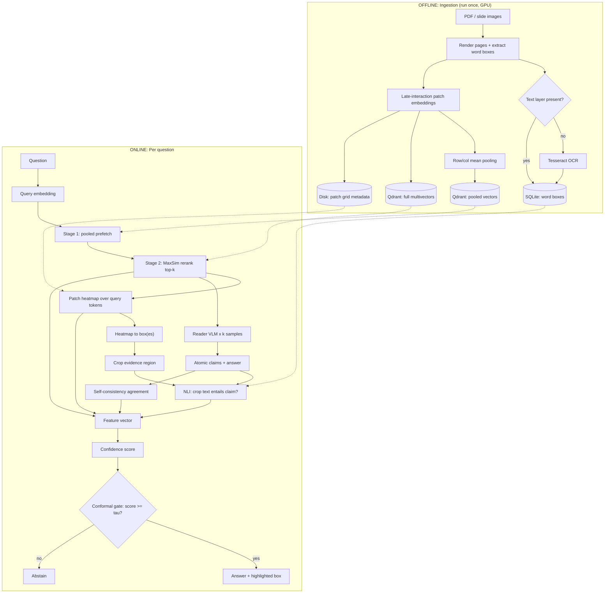

# projectGuideline.md

**Audience:** Muse Spark 1.3 (implementing agent)
**Project:** Verifiable Visual RAG, "cheaper and faster" variant with a conformal abstention gate
**Goal:** Build every component from scratch, run the experiments, and produce the numbers needed for a research article.

---

## 0. How to use this document

1. Read the whole file before writing any code.
2. Build in the **phase order** of Section 12. Do not start a phase until the previous phase's acceptance tests pass.
3. Where this document names a library, **inspect the installed version** (`pip show`, `help()`, source) and the official docs before calling its API. Do not guess method names or tensor shapes. Where a model ID or dataset ID is uncertain, verify it on the Hugging Face Hub or the provider's docs and record what you used in `docs/decisions.md`.
4. Keep every provider, model name, threshold and path in `config.yaml` or `.env`. **Nothing is hardcoded.** Free-tier models change without notice.
5. Log every non-obvious decision and every deviation from this guide in `docs/decisions.md`.
6. If something in this guide is impossible or ambiguous, choose the simplest option that preserves the research design (Section 1), document it, and continue.

---

## 1. Research design (do not change)

We reproduce the *idea* of a three-stage verifiable document-QA system (retrieve, ground, verify or abstain) with these deliberate changes, which are the article's contributions:

| # | Change | Replaces |
|---|---|---|
| C1 | **Patch-similarity heatmap grounding** from the retriever's own MaxSim scores | OCR/text-span snapping and reader-drawn boxes |
| C2 | **Self-consistency** (sample the reader k times) | A separate verifier VLM with 3 workers |
| C3 | **NLI entailment on the cropped evidence region** | Full-page VLM verification |
| C4 | **Conformal abstention gate** with a statistical risk guarantee | Fixed threshold (sigma >= 6.0) |

The experiments must let us **isolate each change** with ablations (Section 10).

### Pipeline (target)



---

## 2. Constraints

- **Free tiers only** for model APIs. No paid keys.
- **Retriever runs locally** on a free GPU (Google Colab or Kaggle). Ingestion is done once; vectors and metadata are exported and reused. The online pipeline must be able to run on a laptop (CPU) using the exported index, with only remote API calls for the reader.
- Everything must be **resumable and cached**: a crashed run must restart without repeating completed API calls.
- Python 3.11+. Single repository. Deterministic where possible (fixed seeds, temperature 0 where specified).
- Target scale: SlideVQA subset first (about 40 to 50 questions for debugging), then the full benchmark subset used in the article.

---

## 3. Repository layout

```
verifiable-visual-rag/
├── README.md
├── projectGuideline.md
├── config.yaml
├── .env.example
├── requirements.txt
├── pyproject.toml
├── docs/
│   └── decisions.md
├── src/vvrag/
│   ├── __init__.py
│   ├── config.py            # load config.yaml + .env, typed dataclasses
│   ├── schemas.py           # all dataclasses / pydantic models (Section 4)
│   ├── cache.py             # disk cache keyed by hash of request
│   ├── ratelimit.py         # token-bucket limiter + retry with backoff
│   ├── logging_utils.py
│   ├── ingest/
│   │   ├── render.py        # PDF/images -> page PNGs + word boxes
│   │   ├── ocr.py           # Tesseract fallback
│   │   ├── embed.py         # patch embeddings (ColPali-family)
│   │   ├── pooling.py       # row/col mean pooling
│   │   ├── index.py         # Qdrant + SQLite writers
│   │   └── run_ingest.py    # CLI
│   ├── retrieve/
│   │   ├── query_embed.py
│   │   ├── two_stage.py     # prefetch + MaxSim rerank
│   │   └── maxsim.py        # local MaxSim (also used for heatmaps)
│   ├── ground/
│   │   ├── heatmap.py       # query-token x patch similarity -> grid
│   │   ├── boxes.py         # grid -> pixel boxes (threshold + components)
│   │   ├── crop.py
│   │   └── text_in_box.py   # word boxes inside a region -> text
│   ├── reader/
│   │   ├── client.py        # provider abstraction (Gemini default)
│   │   ├── prompts.py
│   │   └── claims.py        # parse atomic claims, normalize answers
│   ├── verify/
│   │   ├── consistency.py   # self-consistency agreement
│   │   ├── nli.py           # entailment on crop text
│   │   ├── vlm_crop_check.py# optional fallback when crop has no text
│   │   └── features.py      # build feature vector
│   ├── gate/
│   │   ├── scorer.py        # confidence score model
│   │   ├── conformal.py     # tau selection (Section 8)
│   │   └── fixed.py         # fixed-threshold baseline
│   ├── pipeline.py          # end-to-end answer(question) -> Result
│   └── eval/
│       ├── datasets.py      # SlideVQA loader + fallbacks
│       ├── gold_regions.py  # derive gold boxes from answer spans
│       ├── metrics.py       # EM, F1, IoU, hit rate, coverage, risk
│       ├── arms.py          # Baseline / Grounded / Verified
│       ├── run_eval.py      # CLI
│       └── report.py        # tables + risk-coverage plots
├── notebooks/
│   └── ingest_colab.ipynb   # thin wrapper calling run_ingest.py on a free GPU
├── scripts/
│   ├── download_data.sh
│   └── make_figures.py
├── tests/
│   ├── test_schemas.py
│   ├── test_pooling.py
│   ├── test_heatmap.py
│   ├── test_boxes.py
│   ├── test_metrics.py
│   ├── test_conformal.py
│   ├── test_consistency.py
│   └── test_pipeline_smoke.py
├── data/                    # gitignored: raw data, page images, index exports
└── results/                 # gitignored except summary tables
```

---

## 4. Data contracts (`schemas.py`)

Define these first; every module uses them. Use `pydantic` or `dataclasses`, with JSON serialization.

```python
Box        = (x0, y0, x1, y1)           # pixel coordinates in the rendered page image, origin top-left
WordBox    = {doc_id, page, text, box, block_id, line_id}
PageMeta   = {doc_id, page, width, height, dpi, grid_h, grid_w, has_text_layer, image_path}
RetrievalHit = {doc_id, page, score, stage1_score}
Heatmap    = {doc_id, page, grid: float[grid_h][grid_w], query_tokens: str[], per_token: float[T][grid_h][grid_w] | None}
Evidence   = {doc_id, page, boxes: Box[], crop_path, crop_text, heat_concentration}
Claim      = {text, answer_span: str | None}
ReaderSample = {sample_id, answer: str, claims: Claim[], raw: str}
Features   = {agreement, entail_prob, retrieval_margin, heat_concentration, n_claims, crop_has_text}
Result     = {question, answer, abstained: bool, score: float, tau: float, evidence: Evidence, samples: ReaderSample[], features: Features, timings: dict, api_calls: int}
```

All coordinates must be consistently in the **rendered page image pixel space**. Write one helper that converts patch-grid cells to pixel boxes and test it (Section 11).

---

## 5. Configuration (`config.yaml` and `.env`)

`.env.example`:

```
GEMINI_API_KEY=
GROQ_API_KEY=
OPENROUTER_API_KEY=
QDRANT_URL=
QDRANT_API_KEY=
HF_TOKEN=
```

`config.yaml` (all values are defaults, change as needed):

```yaml
render:
  dpi: 150
retriever:
  model_id: "vidore/colqwen2-v1.0"     # verify on the Hub; fall back to a ColPali model if unavailable
  device: "cuda"
  dtype: "bfloat16"
  prefetch_k_multiplier: 4              # stage 1 fetches 4*k
  top_k: 3
  pooling: "row_col_mean"
qdrant:
  mode: "local"                         # local | cloud
  path: "data/qdrant"
  collection_full: "pages_full"
  collection_pooled: "pages_pooled"
reader:
  provider: "gemini"                    # gemini | groq | openrouter
  model: "CONFIGURE_ME"                 # pick a free multimodal model from the provider's current list
  n_samples: 3
  temperature: 0.7
  max_output_tokens: 512
  max_claims: 5
nli:
  model_id: "cross-encoder/nli-deberta-v3-base"
  device: "cpu"
ground:
  heat_threshold_rel: 0.5               # fraction of max after normalization
  min_box_area_frac: 0.002
  max_boxes: 3
  box_padding_px: 8
gate:
  mode: "conformal"                     # conformal | fixed
  alpha: 0.10                           # target accepted-answer error rate
  delta: 0.10                           # confidence level of the guarantee is 1 - delta
  fixed_tau: 0.5
ratelimit:
  requests_per_minute: 10               # set below the provider's real limit
  max_retries: 6
eval:
  dataset: "slidevqa"
  n_debug: 45
  seed: 42
  calib_frac: 0.5                       # split of eval questions used for calibration
cache_dir: "data/cache"
```

---

## 6. Offline ingestion

### 6.1 Render and word boxes (`render.py`)

- Use **PyMuPDF** to render each PDF page at `render.dpi` to PNG. If the dataset provides page images instead of PDFs, load them directly and skip text-layer extraction.
- For PDFs with a text layer, extract word boxes (`page.get_text("words")` or equivalent) and **scale them from PDF points to pixels** using dpi/72. Store `block_id` and `line_id` where available.
- Record `has_text_layer` per page (true if the page has a meaningful number of words).

### 6.2 OCR fallback (`ocr.py`)

- If a page has no text layer (or the input is images), run **Tesseract** (`pytesseract.image_to_data`) and convert results to `WordBox` with confidence filtering (drop low-confidence junk).
- Make languages configurable (`eng` by default; `nep`/`hin` optional for later Devanagari experiments).

### 6.3 Patch embeddings (`embed.py`)

- Use the **colpali-engine** package with a ColQwen2-family checkpoint (`retriever.model_id`). Run on a free GPU in batches; keep memory low (bfloat16, small batch, `torch.no_grad()`).
- For every page, store:
  - the **multivector** (one vector per image patch; also keep or drop special/prefix tokens as the model requires),
  - the **patch grid shape** `(grid_h, grid_w)` for that page.
- **Critical:** ColQwen2 uses dynamic resolution, so the grid differs per page. Derive `(grid_h, grid_w)` from the processor's output (e.g. the image grid metadata and the spatial merge size), not from assumptions. Write a test that the number of patch vectors equals `grid_h * grid_w` (plus any known special tokens), and record exactly how you obtained the grid in `docs/decisions.md`.
- Save embeddings to disk (`data/index/embeddings/{doc_id}_{page}.npy`) in float16 so ingestion is resumable and exportable.

### 6.4 Pooling (`pooling.py`)

- Reshape each page's patch vectors to `(grid_h, grid_w, dim)`. Compute **row means** (`grid_h` vectors) and **column means** (`grid_w` vectors). Optionally also a global mean.
- Pooled vectors are used only for **stage 1 prefetch**. Unit-test with a tiny synthetic grid where the answer is known by hand.

### 6.5 Indexing (`index.py`)

- **Qdrant** (local mode by default, cloud optional) with two collections:
  - `pages_full`: multivector per page, configured with the **MaxSim** multivector comparator.
  - `pages_pooled`: pooled vectors, with payload `{doc_id, page}`.
- **SQLite** table `word_boxes(doc_id, page, text, x0, y0, x1, y1, block_id, line_id)` plus a `pages` table with `PageMeta`.
- Ingestion must be **idempotent**: re-running skips pages already indexed.

### 6.6 CLI and Colab

- `python -m vvrag.ingest.run_ingest --input data/raw --out data/index`
- `notebooks/ingest_colab.ipynb` only installs dependencies, mounts storage, calls the CLI, and zips `data/index` for download. No logic in the notebook.

**Acceptance (phase 2):** ingest 3 small PDFs; Qdrant contains the expected number of points; SQLite contains word boxes; pooled vector count equals `grid_h + grid_w` per page.

---

## 7. Online pipeline

### 7.1 Retrieval (`retrieve/`)

1. Embed the question with the same model (query multivector, one vector per query token). Record the query token strings (needed for heatmap labels and for dropping padding/special tokens from the heatmap).
2. **Stage 1:** search `pages_pooled` with the query vectors, fetch `retriever.prefetch_k_multiplier * top_k` candidate pages.
3. **Stage 2:** rerank candidates with **exact MaxSim** over full multivectors (use Qdrant's multivector search restricted to the candidate ids, or compute MaxSim locally via `maxsim.py`).
4. Return `top_k` `RetrievalHit`s and keep `retrieval_margin = score_top1 - score_top2` as a feature.

`maxsim.py` must implement MaxSim as: for each query token, take the max dot product over page patches, then sum over query tokens. Unit-test against a brute-force NumPy reference.

### 7.2 Heatmap grounding (`ground/`) (contribution C1)

For the top-1 page (and optionally top-2):

1. Compute the similarity matrix `S[t, p]` between each query token `t` and each patch `p` (shape `T x grid_h*grid_w`).
2. **Token filtering:** drop special/padding/instruction tokens (verify which ones your model's query processor adds). Keep content tokens.
3. Aggregate to a patch score: default `heat[p] = max_t S[t, p]` or the mean over tokens; make the aggregation a config option and compare both in an ablation. Optionally weight tokens by their own max score.
4. Reshape to `(grid_h, grid_w)`, normalize to `[0, 1]` (min-max per page), optionally smooth with a small Gaussian.
5. **Grid to boxes (`boxes.py`):** threshold at `heat_threshold_rel`, find connected components, drop components below `min_box_area_frac`, convert each cell range to **pixel boxes** using `PageMeta.width/height` and the grid shape, pad by `box_padding_px`, keep the top `max_boxes` by summed heat.
6. **Crop (`crop.py`):** crop the union (or each box) from the page image and save it; the crop is what the reader may see and what NLI checks.
7. **`heat_concentration`:** a scalar in `[0, 1]` measuring how peaked the heatmap is (for example 1 minus normalized entropy, or the fraction of total heat inside the chosen boxes). This is a gate feature.
8. **Text in box (`text_in_box.py`):** collect `WordBox`es whose centers fall inside the evidence boxes, join in reading order (sort by block, line, x) to produce `crop_text`. If there are no word boxes (no text layer and OCR found nothing), run Tesseract on the crop; if still empty, set `crop_has_text = False`.

Optional enhancement (behind a flag, off by default): **snap** each heatmap box to the nearest word-box line boundaries for tighter highlights. Evaluate it as a separate ablation arm.

### 7.3 Reader (`reader/`)

- Provider abstraction with one method: `generate(images: list[Path], prompt: str, temperature: float, n: int) -> list[str]`. Default provider is **Gemini** via its official Python SDK; **Groq** and **OpenRouter** are alternative implementations of the same interface. Read the provider's current docs for how to pass images and request JSON output.
- Wrap every call with `cache.py` (key = hash of provider, model, prompt, image hashes, temperature, sample index) and `ratelimit.py` (token bucket + exponential backoff with jitter on 429/5xx).
- **Input to the reader:** the question, the top-1 page image, and the evidence crop (as a second image) with an instruction that the crop is the region likely to contain the answer.
- **Prompt requirements** (`prompts.py`): the reader must return strict JSON:

```json
{
  "answer": "short final answer",
  "claims": [
    {"text": "one atomic, self-contained factual statement supporting the answer",
     "answer_span": "the exact words from the document that support it, or null"}
  ]
}
```

- Atomic means one fact per claim and no pronouns without referents. Cap at `max_claims`. Tell the model to say `"answer": "UNANSWERABLE"` if the page does not contain the answer.
- Parse robustly (strip code fences, retry once on invalid JSON, then mark the sample as failed).
- Draw `reader.n_samples` samples: sample 0 at temperature 0 (the "primary" answer) and the rest at `reader.temperature`.
- **Answer normalization** (`claims.py`): lowercase, strip punctuation and articles, normalize numbers and units, used for EM/F1 and for agreement.

### 7.4 Verification (`verify/`) (contributions C2 and C3)

**Self-consistency (`consistency.py`).** `agreement` = fraction of the `k` samples whose normalized answer matches the primary answer (exact after normalization, or token-F1 >= 0.8). Also record the number of distinct answers. Unit-test with fixed lists.

**NLI entailment (`nli.py`).**
- Load the cross-encoder NLI model on CPU. Premise = `crop_text` (truncate to the model's max length; if longer, slide a window over sentences and take the **max** entailment probability). Hypothesis = claim text.
- Output `entail_prob` per claim via softmax over the model's label order (**read the model card/config for label ids; do not assume**). Aggregate across claims: use the **minimum** (strict: every claim must be supported) as the main feature and also store the mean.
- If `crop_has_text` is False, NLI is not applicable: set `entail_prob = None`, and optionally call `vlm_crop_check.py`.

**Optional VLM crop check (`vlm_crop_check.py`).** Behind a flag (`verify.vlm_fallback: false` by default). Sends the crop and claim to a **different-family** free VLM (for example Groq or OpenRouter if the reader is Gemini) and asks "Does this image support this statement? Answer yes/no." Use only when the crop has no text, to keep API usage low.

**Features (`features.py`).** Build `Features` exactly as in Section 4. Missing values must be encoded consistently (for example `entail_prob = 0.5` plus `crop_has_text = 0`) and documented.

---

## 8. Conformal abstention gate (contribution C4)

### 8.1 Confidence scorer (`gate/scorer.py`)

- Input: `Features`. Output: a scalar `score` in `[0, 1]` where higher means "more likely correct".
- Default scorer: a **logistic regression** (scikit-learn) trained on the **training split** of the eval questions, with label = 1 if the primary answer is correct (F1 >= 0.5 against gold, configurable; report EM too), else 0. Standardize features first.
- Provide a simple **hand-weighted baseline** scorer (for example `0.4*agreement + 0.4*entail_prob + 0.2*heat_concentration`) so the article can show the learned scorer helps.
- Keep scorer training strictly **separate** from the calibration split used below (three-way split: train / calibration / test).

### 8.2 Threshold selection (`gate/conformal.py`)

Goal: choose `tau` so that, among questions the system **answers** (score >= tau), the error rate is at most `alpha` with probability at least `1 - delta`, assuming exchangeability between calibration and test questions.

Implement **risk-controlling threshold selection with fixed-sequence testing** (Learn-then-Test style):

1. On the calibration set, compute `score_i` and `error_i` (1 if the answer is wrong).
2. Candidate thresholds: the sorted unique calibration scores, descending (strictest first).
3. For each candidate `tau` in that order, let `n_acc` = number of calibration points with `score >= tau` and `k_err` = errors among them. Compute a **one-sided upper confidence bound** on the true error rate of accepted answers with a **Clopper-Pearson** bound at level `delta` (use `scipy.stats.beta`).
4. Walk down the sequence; the chosen `tau*` is the **smallest** threshold whose upper bound is `<= alpha`, **stopping at the first threshold that fails** (this is what makes fixed-sequence testing valid without a multiplicity correction).
5. If even the strictest threshold fails, return `tau = +inf` (always abstain) and log a warning.
6. Also implement the simpler **split-conformal** variant as a secondary method: nonconformity of correct calibration answers is `1 - score`; choose `tau` as the appropriate finite-sample quantile so that a correct test answer is accepted with probability at least `1 - delta'`. Report both and explain the difference in the article (risk control on accepted answers vs. coverage of correct answers).

Tests (`test_conformal.py`):
- On synthetic data where the score is perfectly separating, `tau*` accepts everything correct.
- On random scores, the method should abstain heavily at small `alpha`.
- **Empirical guarantee check:** repeat random calibration/test splits (for example 200 times) on a synthetic or real score set and verify the fraction of splits where test error among accepted exceeds `alpha` is at most about `delta` (allow tolerance).

### 8.3 Fixed baseline (`gate/fixed.py`)

Accept if `score >= gate.fixed_tau`. Used as the comparison in the ablation.

---

## 9. End-to-end pipeline (`pipeline.py`)

`answer(question, corpus_filter=None) -> Result`:

1. Retrieve top-k pages.
2. Build heatmap, boxes, crop and `crop_text` for the top-1 page.
3. Run the reader `k` times (cached).
4. Compute agreement, NLI and features.
5. Score, apply gate, and return `Result` with `abstained` set accordingly.
6. Record timings per stage and the number of external API calls (for the cost analysis).

Also expose `python -m vvrag.pipeline --question "..." --corpus data/index` for manual demos, writing the page image with highlighted boxes to `results/demo/`.

---

## 10. Evaluation (`eval/`)

### 10.1 Data

- **Primary:** SlideVQA (single-page-answerable subset). Locate the official release or the Hugging Face dataset, download via `scripts/download_data.sh`, and document the exact source and version in `docs/decisions.md`. Use a fixed subset of decks (record the deck ids).
- **Fallbacks** if SlideVQA is unavailable: a DocVQA or InfographicVQA subset, or ViDoRe pages. Note this clearly.
- Split questions into **train / calibration / test** (default 30% / 30% / 40%) by **deck**, not by question, to avoid leakage. Fixed seed.

### 10.2 Gold regions (`gold_regions.py`)

- No manual annotation. Derive the gold region from the answer span: find the answer string (normalized) in the page's word boxes (exact then fuzzy match), take the union box of matched words (expand to the containing line or block as a configurable option). Questions where no match is found are excluded from the **localization** metrics only (still used for answer metrics). Report how many questions have derived gold regions.

### 10.3 Arms

| Arm | Description |
|---|---|
| **Baseline** | Retrieve + reader only (sample 0), no grounding, no abstention |
| **Grounded** | Baseline + heatmap evidence box (answers always returned) |
| **Verified-fixed** | Grounded + self-consistency + NLI + fixed-threshold gate |
| **Verified-conformal** | Same features, conformal gate (**our full system**) |

### 10.4 Ablations (each must be runnable from the CLI via flags)

1. **Grounding:** heatmap max vs. mean aggregation; heatmap vs. heatmap+word-box snapping.
2. **Verification components:** agreement only, NLI only, both, plus heat concentration and retrieval margin.
3. **Self-consistency size:** `k = 1, 3, 5`.
4. **Gate:** hand-weighted vs. learned scorer; fixed vs. conformal; `alpha` in `{0.05, 0.10, 0.20}`.
5. **Retrieval:** pooled prefetch multiplier (for example 2, 4, 8) and its effect on recall and latency.

### 10.5 Metrics (`metrics.py`)

- **Answer:** Exact Match, token F1 (after normalization).
- **Retrieval:** hit rate at k (is the gold page in top-k), MRR.
- **Localization:** IoU between predicted union box and gold box, and **hit rate at IoU >= 0.3 / 0.5**; also "gold box center inside predicted box".
- **Selective prediction:** **coverage** (fraction answered), **selective accuracy / error among answered**, **confident-wrong rate** (answered and wrong, divided by all questions), **risk-coverage curve** and its area (AURC).
- **Conformal check:** realized error among accepted test answers vs. `alpha`.
- **Efficiency:** mean and p95 latency per question, API calls per question, tokens if available, index size per page.
- Report **bootstrap 95% confidence intervals** for the main metrics (1000 resamples).

### 10.6 Outputs (`report.py`)

- `results/runs/{run_id}/predictions.jsonl` (one `Result` per question, including features and timings).
- `results/runs/{run_id}/summary.json` and `summary.md` (tables).
- `results/figures/`: risk-coverage curves (all arms on one plot), IoU histograms, latency bars, calibration scatter (score vs. correctness).
- A single **main results table** in Markdown and LaTeX for the article.

---

## 11. Testing

- `pytest` must pass before each phase is declared done.
- Unit tests listed in the repo layout, plus:
  - **Coordinate test:** a synthetic page where a known patch cell lights up; the resulting pixel box must contain the expected region within one patch of tolerance.
  - **Grid test:** patch-vector count equals `grid_h * grid_w` (plus declared special tokens) for pages of different aspect ratios.
  - **Metric tests:** EM/F1/IoU against hand-computed examples.
  - **Smoke test:** the full pipeline on 2 tiny documents with a **mocked reader** (returns canned JSON) so tests need no API keys or GPU (use a small deterministic fake embedder behind the same interface).
- Add an `--offline-mock` switch to the pipeline so the whole system can be exercised without network access.

---

## 12. Build order and acceptance criteria

| Phase | Deliverable | Acceptance |
|---|---|---|
| **1** | Repo skeleton, `config.py`, `schemas.py`, `cache.py`, `ratelimit.py`, logging, mock providers | `pytest` passes; config loads; cache returns stored values on the second call |
| **2** | Ingestion (render, OCR, embed, pool, index) | 3 PDFs ingest end to end on a GPU; pooled counts correct; resumable |
| **3** | Retrieval (two-stage + MaxSim) | Hit rate at 3 above 0.8 on a 20-question debug set; local MaxSim matches Qdrant ordering |
| **4** | Heatmap grounding, boxes, crops, crop text | Saved overlay images visibly highlight the answer area on at least 8 of 10 manually inspected pages; coordinate test passes |
| **5** | Reader client + prompts + claim parsing | Valid JSON on at least 95% of calls on the debug set; cache and rate limiter work under a forced 429 |
| **6** | Self-consistency, NLI, features | Feature vectors produced for the debug set; label order of the NLI model verified |
| **7** | Scorer + conformal gate (+ fixed baseline) | Conformal tests pass, including the empirical guarantee check |
| **8** | Evaluation harness, arms, metrics, report | All 4 arms run on the debug subset and produce tables and figures |
| **9** | Full runs and ablations | Complete results with confidence intervals; `decisions.md` lists models, dates and deviations |
| **10** | README, reproducibility, demo | A fresh clone can reproduce the debug run from `README.md` alone |

After each phase: commit, update `docs/decisions.md`, and write a 5-line status note (what works, what is stubbed, known issues).

---

## 13. Free-tier handling rules

- Default **reader**: Gemini free tier (multimodal). Pick the model from the provider's current free list and put it in `config.yaml`; do not hardcode.
- Default **optional VLM fallback / alternative reader**: Groq or OpenRouter free models, always a different family from the reader.
- **NLI, embeddings (offline), OCR, vector DB, SQLite:** all local and free.
- Every external call goes through `cache.py` and `ratelimit.py`. Set `requests_per_minute` below the real limit.
- Keep a **call counter** per run. Before a full run, estimate `n_questions * n_samples` calls and compare with the daily quota; if it does not fit, split the run across days (the cache makes this safe) or reduce `n_samples`.
- On quota exhaustion: stop cleanly, write a checkpoint, print how to resume. Never silently skip questions.
- Never print or log API keys. Never commit `.env`.

---

## 14. Quality bar and pitfalls

- **Leakage:** the scorer, the calibration set and the test set must be disjoint by deck. State the split sizes in the report.
- **Exchangeability:** conformal guarantees assume calibration and test questions come from the same distribution. Do not tune on the test split. Mention this assumption in the article.
- **Label noise:** correctness is judged by automatic F1 against a single gold answer; this undercounts valid paraphrases. Report the threshold used and, if time allows, manually audit 50 predictions.
- **Heatmap quirks:** query-token padding and instruction tokens can dominate similarity; verify the filtering by visualizing per-token maps for a few queries.
- **Grid mismatch:** the most likely silent bug is a wrong `(grid_h, grid_w)`; boxes will look shifted or squashed. The grid and coordinate tests exist for this reason.
- **NLI domain shift:** NLI models are trained on sentence pairs, not slides. Slide text is often fragmentary, so also report results with NLI removed from the features to show its marginal value.
- **Reproducibility:** fix seeds, log package versions (`pip freeze` into each run folder), and log the exact model names and dates, since free-tier models change.

---

## 15. Definition of done

- [ ] All phases 1 to 10 complete and `pytest` green.
- [ ] Index exported from Colab/Kaggle and loadable on CPU.
- [ ] Four arms and all listed ablations run on the final test split.
- [ ] Main results table (Markdown and LaTeX), risk-coverage plot, localization results and efficiency table generated by one command: `python -m vvrag.eval.run_eval --config config.yaml --all`.
- [ ] Empirical check shows the realized error among accepted answers is at or below `alpha` in about `1 - delta` of random calibration/test splits.
- [ ] `docs/decisions.md` records every model, dataset source, deviation and known limitation.
- [ ] `README.md` explains setup, free-key creation, how to ingest, how to run a single question, and how to reproduce the paper's tables.

---

## 16. Final instructions to the implementing agent

1. Start with Phase 1 and report what you built, then continue phase by phase.
2. If you must choose between speed and correctness in the coordinate, grid, or conformal code, choose correctness.
3. Do not add features outside this document until the definition of done is met.
4. When you finish each phase, list the tests that passed and any assumptions you made.